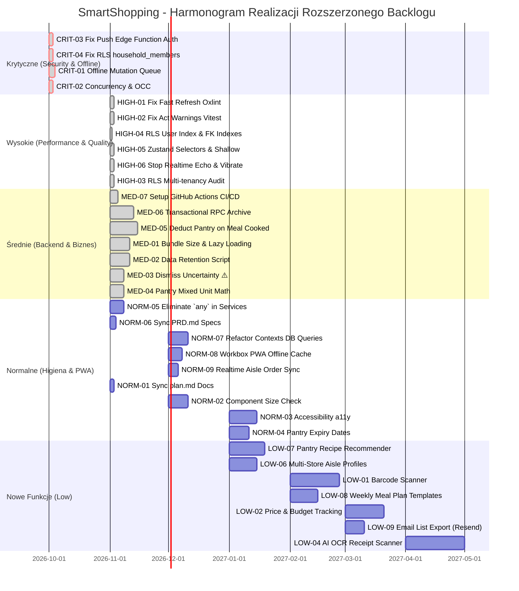

# SmartShopping - Kompleksowa Mapa Drogowa (Roadmap & Backlog)

> **Status dokumentu:** Aktywny / Żywy backlog techniczno-biznesowy  
> **Data utworzenia:** Październik 2026  
> **Źródło:** Audyt całościowy kodu, architektury, testów, bezpieczeństwa oraz spójności z [PRD](./PRD.md) i [plan.md](./plan.md)  
> **Konstytucja projektu:** [AGENTS.md](../AGENTS.md) | [.agents/rules/](../.agents/rules/)

---

## 1. Wstęp i Metodologia Kategoryzacji

Niniejszy dokument stanowi jednolity rejestr zadań naprawczych, optymalizacyjnych oraz rozwojowych dla aplikacji **SmartShopping**. Zgłoszenia zostały podzielone na 5 ustandaryzowanych kategorii priorytetu:

| Poziom Priorytetu | Znaczenie i Kryteria Kwalifikacji |
| :--- | :--- |
| 🔴 **Critical** | Błędy krytyczne, ryzyko utraty danych (np. utrata odhaczeń w markecie offline), dziury w bezpieczeństwie, awarie blokujące kluczowe procesy użytkownika. |
| 🟠 **High** | Istotne długi techniczne, błędy lintera psujące dewelopment (Fast Refresh), wycieki w testach (`act(...)`), weryfikacja szczelności RLS i multi-tenancy. |
| 🟡 **Medium** | Optymalizacje wydajności (Bundle Size / Code Splitting), higiena bazy danych (retencja danych w Supabase), istotne usprawnienia UX/biznesowe (np. wyciszanie niepewności w kalendarzu). |
| 🟢 **Normal** | Standardowe ulepszenia jakościowe: czyszczenie dokumentacji, dbałość o rozmiar komponentów (<250-300 linii), podstawy dostępności cyfrowej (a11y/WCAG), rozszerzenia spiżarni. |
| 🔵 **Low** | Nowe innowacyjne moduły i funkcjonalności (Skaner kodów kreskowych, śledzenie cen i budżetu, AI OCR paragonów, tryb gościa, aplikacje na zegarki). |

---

## 2. 🔴 Kategoria CRITICAL (Najwyższy Priorytet)

### CRIT-01: Offline Mutation Queue & Background Sync w Markecie (Zero-Connectivity Resilience)
* **Status:** ✅ **Zrealizowane (Październik 2026)**
* **Obszar:** Frontend / State Management (`Zustand`, `localStorage`, `PWA Background Sync`)
* **Pliki implementacji:** [offlineMutationQueue.ts](file:///d:/08_Git/SmartShopping/SmartShopping/src/lib/offline/offlineMutationQueue.ts), [useOfflineSync.ts](file:///d:/08_Git/SmartShopping/SmartShopping/src/hooks/useOfflineSync.ts), [ActiveListView.tsx](file:///d:/08_Git/SmartShopping/SmartShopping/src/components/views/ActiveListView.tsx), [DesktopActiveListView.tsx](file:///d:/08_Git/SmartShopping/SmartShopping/src/components/layout/desktop/views/DesktopActiveListView.tsx), [AppLayoutRouter.tsx](file:///d:/08_Git/SmartShopping/SmartShopping/src/components/layout/AppLayoutRouter.tsx)
* **Pliki testów:** [offlineMutationQueue.test.ts](file:///d:/08_Git/SmartShopping/SmartShopping/src/lib/offline/__tests__/offlineMutationQueue.test.ts), [ActiveListView.test.tsx](file:///d:/08_Git/SmartShopping/SmartShopping/src/components/views/__tests__/ActiveListView.test.tsx)
* **Problem / Uzasadnienie:**
  * W supermarketach i podziemnych halach zasięg sieci komórkowej ulega częstemu zerwaniu.
  * Dotychczasowy mechanizm przy odhaczaniu (`toggleItemChecked`) przy błędzie sieciowym natychmiast wywoływał `rollbackState()`.
  * Skutek: Użytkownik odhacza 5-10 kupionych artykułów, po czym z powodu utraty łączności aplikacja cofała zaznaczenia, wywołując dezorientację i powtórne zakupy.
* **Wdrożone Rozwiązanie:**
  1. Wprowadzono moduł kolejki mutacji offline ([offlineMutationQueue.ts](file:///d:/08_Git/SmartShopping/SmartShopping/src/lib/offline/offlineMutationQueue.ts)) oparty o `localStorage` z odpornością na restarty przeglądarki.
  2. W przypadku braku połączenia lub błędu zapytania sieciowego stan w UI **nie jest cofany** (brak rollbacku) – mutacja trafia do kolejki ze statusem oczekiwania na synchronizację.
  3. Zarejestrowano nasłuchiwanie zdarzenia `window.addEventListener('online')` w hooku [useOfflineSync.ts](file:///d:/08_Git/SmartShopping/SmartShopping/src/hooks/useOfflineSync.ts) podpiętym w głównym routerze aplikacji ([AppLayoutRouter.tsx](file:///d:/08_Git/SmartShopping/SmartShopping/src/components/layout/AppLayoutRouter.tsx)).
  4. Po powrocie połączenia kolejka jest sekwencyjnie opróżniana z mechanizmem retry i aktualizacją bazodanową w Supabase.
* **Definition of Done (DoD) - Rezultat:**
  - ✅ Wyłączenie sieci (Chrome DevTools: Offline / `navigator.onLine = false`) i odhaczenie pozycji nie wywołuje rollbacku.
  - ✅ Włączenie sieci automatycznie przesyła mutacje do Supabase bez konieczności odświeżania strony.
  - ✅ Pełne pokrycie testami jednostkowymi i integracyjnymi w `offlineMutationQueue.test.ts` oraz `ActiveListView.test.tsx`.

---

### CRIT-02: Optymistyczna Kontrola Współbieżności i Rozwiązywanie Konfliktów Realtime (OCC)
* **Status:** ✅ **Zrealizowane (Październik 2026)**
* **Obszar:** Backend / Baza Danych / Realtime
* **Pliki implementacji:** [20261026151000_shopping_list_items_occ.sql](file:///d:/08_Git/SmartShopping/SmartShopping/supabase/migrations/20261026151000_shopping_list_items_occ.sql), [shoppingItemConflict.ts](file:///d:/08_Git/SmartShopping/SmartShopping/src/lib/calculations/shoppingItemConflict.ts), [shoppingListService.ts](file:///d:/08_Git/SmartShopping/SmartShopping/src/services/shoppingListService.ts), [supabase.ts](file:///d:/08_Git/SmartShopping/SmartShopping/src/types/supabase.ts)
* **Pliki testów:** [shoppingItemConflict.test.ts](file:///d:/08_Git/SmartShopping/SmartShopping/src/lib/calculations/__tests__/shoppingItemConflict.test.ts)
* **Problem / Uzasadnienie:**
  * Gdy dwóch domowników robi zakupy jednocześnie w różnych alejkach, może dojść do sytuacji Last-Write-Wins bez walidacji znacznika czasu.
  * Zdarzenie WebSocket z opóźnionego telefonu mogło nadpisać nowszy stan pozycji na serwerze i odznaczyć kupiony produkt.
* **Wdrożone Rozwiązanie:**
  1. Dodano kolumnę `updated_at TIMESTAMPTZ DEFAULT NOW()` oraz automatyczny trigger aktualizujący `set_shopping_list_item_updated_at` w migracji [20261026151000_shopping_list_items_occ.sql](file:///d:/08_Git/SmartShopping/SmartShopping/supabase/migrations/20261026151000_shopping_list_items_occ.sql).
  2. Wdrożono algorytm scalania konfliktów ([shoppingItemConflict.ts](file:///d:/08_Git/SmartShopping/SmartShopping/src/lib/calculations/shoppingItemConflict.ts)) z kluczową regułą biznesową: jeśli którykolwiek z partnerów oznaczył produkt jako kupiony (`is_checked = true`), stan ten pozostaje nadrzędny i nie ulega cofnięciu przez opóźniony pakiet.
  3. Zaktualizowano metodę `toggleItemChecked` w [shoppingListService.ts](file:///d:/08_Git/SmartShopping/SmartShopping/src/services/shoppingListService.ts) o weryfikację współbieżną `clientTimestamp`.
* **Definition of Done (DoD) - Rezultat:**
  - ✅ Brak utraty stanu odhaczenia przy symulacji opóźnionego pakietu WebSocket / sieciowego z drugiego urządzenia.
  - ✅ Zestaw testów jednostkowych w `shoppingItemConflict.test.ts` weryfikujący wszystkie warianty współbieżnych edycji.

---

### CRIT-03: Zabezpieczenie Edge Function Powiadomień Push (Weryfikacja Przynależności do Household)
* **Status:** ✅ **Zrealizowane (Październik 2026)**
* **Obszar:** Backend / Bezpieczeństwo / Supabase Edge Functions
* **Pliki implementacji:** [send-push-notification/index.ts](file:///d:/08_Git/SmartShopping/SmartShopping/supabase/functions/send-push-notification/index.ts)
* **Pliki testów:** [notificationService.test.ts](file:///d:/08_Git/SmartShopping/SmartShopping/src/services/__tests__/notificationService.test.ts)
* **Problem / Uzasadnienie:**
  * W funkcji [send-push-notification/index.ts](file:///d:/08_Git/SmartShopping/SmartShopping/supabase/functions/send-push-notification/index.ts) weryfikowany był jedynie ogólny token użytkownika (`userClient.auth.getUser()`), po czym pobierano subskrypcje z tabeli `push_subscriptions` kluczem `service_role` omijającym RLS wyłącznie po `householdId` z payloadu JSON.
  * **Luka:** Zalogowany użytkownik mógł wysłać POST z cudzym `householdId` i rozsyłać powiadomienia push na obce urządzenia.
* **Wdrożone Rozwiązanie:**
  1. Wprowadzono weryfikację przynależności użytkownika do wnioskowanego gospodarstwa domowego w tabeli `household_members` przed pobraniem subskrypcji urządzeń:
     ```typescript
     const { data: member, error: memberError } = await supabaseClient
       .from('household_members')
       .select('id')
       .eq('household_id', householdId)
       .eq('user_id', user.id)
       .maybeSingle();

     if (memberError || !member) {
       return new Response(JSON.stringify({ error: "Forbidden: You are not a member of this household" }), {
         status: 403,
         headers: { ...corsHeaders, "Content-Type": "application/json" }
       });
     }
     ```
* **Definition of Done (DoD) - Rezultat:**
  - ✅ Próba wysłania powiadomienia do gospodarstwa, do którego wywołujący użytkownik nie należy, zostaje zablokowana statusem HTTP 403 Forbidden.

---

### CRIT-04: Uszczelnienie Polityki RLS w `household_members` (Blokada Samowolnego Dołączania do Gospodarstw)
* **Status:** ✅ **Zrealizowane (Październik 2026)**
* **Obszar:** Baza Danych / Bezpieczeństwo / Supabase RLS & RPC
* **Pliki implementacji:** [20261026150000_secure_household_members_rls.sql](file:///d:/08_Git/SmartShopping/SmartShopping/supabase/migrations/20261026150000_secure_household_members_rls.sql), [householdService.ts](file:///d:/08_Git/SmartShopping/SmartShopping/src/services/householdService.ts), [supabase.ts](file:///d:/08_Git/SmartShopping/SmartShopping/src/types/supabase.ts)
* **Pliki testów:** [householdService.test.ts](file:///d:/08_Git/SmartShopping/SmartShopping/src/services/__tests__/householdService.test.ts)
* **Problem / Uzasadnienie:**
  * W pierwotnej migracji polityka `INSERT` dla tabeli `household_members` zawierała warunek `WITH CHECK (user_id = auth.uid() OR ...)`.
  * Ponieważ warunek `user_id = auth.uid()` był zawsze spełniony przy wstawianiu własnego ID, **użytkownik znający UUID obcego gospodarstwa mógł samodzielnie dopisać się do niego bez zaproszenia**, zyskując natychmiastowy dostęp do wszystkich danych.
* **Wdrożone Rozwiązanie:**
  1. Usunięto podatną politykę `INSERT` i wdrożono nową, bezpieczną politykę w migracji [20261026150000_secure_household_members_rls.sql](file:///d:/08_Git/SmartShopping/SmartShopping/supabase/migrations/20261026150000_secure_household_members_rls.sql):
     - Dopisanie do gospodarstwa dozwolone jest wyłącznie przez istniejącego członka gospodarstwa LUB przez użytkownika posiadającego aktywne zaproszenie w `household_invites` powiązane z jego adresem e-mail.
  2. Dodano procedurę składowaną `public.create_household_with_member(p_name TEXT)` z klauzulą `SECURITY DEFINER`, umożliwiającą bezpieczne tworzenie nowego gospodarstwa i atomowe przypisanie twórcy jako pierwszego członka.
  3. Zintegrowano [householdService.ts](file:///d:/08_Git/SmartShopping/SmartShopping/src/services/householdService.ts) z funkcją RPC `create_household_with_member`.
* **Definition of Done (DoD) - Rezultat:**
  - ✅ Próba bezpośredniego dodania rekordu do `household_members` bez zaproszenia jest blokowana przez PostgreSQL RLS.
  - ✅ Tworzenie nowego gospodarstwa oraz dołączanie przez zaproszenia e-mail działają bez zakłóceń. Pokryte testami jednostkowymi w `householdService.test.ts`.

---

## 3. 🟠 Kategoria HIGH (Wysoki Priorytet)

### HIGH-01: Likwidacja Ostrzeżeń Fast Refresh w Linterze (`oxlint`)
* **Status:** ✅ **Zrealizowane (Listopad 2026)**
* **Obszar:** Frontend / Tooling / Developer Experience
* **Pliki implementacji:** [button.variants.ts](file:///d:/08_Git/SmartShopping/SmartShopping/src/components/ui/button.variants.ts), [button.tsx](file:///d:/08_Git/SmartShopping/SmartShopping/src/components/ui/button.tsx), [badge.variants.ts](file:///d:/08_Git/SmartShopping/SmartShopping/src/components/ui/badge.variants.ts), [badge.tsx](file:///d:/08_Git/SmartShopping/SmartShopping/src/components/ui/badge.tsx), [authContextDef.ts](file:///d:/08_Git/SmartShopping/SmartShopping/src/context/authContextDef.ts), [AuthContext.tsx](file:///d:/08_Git/SmartShopping/SmartShopping/src/context/AuthContext.tsx), [useAuth.ts](file:///d:/08_Git/SmartShopping/SmartShopping/src/hooks/useAuth.ts)
* **Problem / Uzasadnienie:**
  * Linter `oxlint` zwracał 3 ostrzeżenia reguły `react(only-export-components)` dla `button.tsx`, `badge.tsx` i `AuthContext.tsx`.
  * Skutek: Naruszenie mechanizmu React Hot Module Replacement (HMR) i reset stanu aplikacji przy edycji plików.
* **Wdrożone Rozwiązanie:**
  1. Wydzielono warianty CVA do plików [button.variants.ts](file:///d:/08_Git/SmartShopping/SmartShopping/src/components/ui/button.variants.ts) oraz [badge.variants.ts](file:///d:/08_Git/SmartShopping/SmartShopping/src/components/ui/badge.variants.ts).
  2. Wydzielono definicję kontekstu do [authContextDef.ts](file:///d:/08_Git/SmartShopping/SmartShopping/src/context/authContextDef.ts) oraz hooka `useAuth` do [useAuth.ts](file:///d:/08_Git/SmartShopping/SmartShopping/src/hooks/useAuth.ts), aktualizując importy i mocki w całym repozytorium.
* **Definition of Done (DoD) - Rezultat:**
  - ✅ Polecenie `npm run lint` wykonuje się z wynikiem `0 warnings and 0 errors`.

---

### HIGH-02: Eliminacja Ostrzeżeń `act(...)` w Środowisku Testowym Vitest
* **Status:** ✅ **Zrealizowane (Listopad 2026)**
* **Obszar:** Testy Automatyczne / Vitest
* **Pliki:** [NotificationSettings.test.tsx](file:///d:/08_Git/SmartShopping/SmartShopping/src/components/settings/__tests__/NotificationSettings.test.tsx), [AccountDetailsTheme.test.tsx](file:///d:/08_Git/SmartShopping/SmartShopping/src/components/dialogs/__tests__/AccountDetailsTheme.test.tsx), [HouseholdsDialog.test.tsx](file:///d:/08_Git/SmartShopping/SmartShopping/src/components/dialogs/__tests__/HouseholdsDialog.test.tsx), [ActiveListView.test.tsx](file:///d:/08_Git/SmartShopping/SmartShopping/src/components/views/__tests__/ActiveListView.test.tsx)
* **Problem / Uzasadnienie:**
  * Podczas uruchamiania `npm run test` w strumieniu `stderr` pojawiały się ostrzeżenia `An update to ... inside a test was not wrapped in act(...)` (z nieoczekiwanych efektów montowania `checkStatus()`, `getHouseholdMembers()` oraz `getActiveListsSummary()` / realnego `notificationService.notify()`).
* **Wdrożone Rozwiązanie:**
  1. W testach `NotificationSettings.test.tsx` i `AccountDetailsTheme.test.tsx` zabezpieczono i spłukano wywołanie `checkStatus()` z `useEffect`.
  2. W `HouseholdsDialog.test.tsx` dodano oczekiwanie na rozwiązanie asynchronicznego `getHouseholdMembers()` przez `await waitFor(...)`.
  3. W `ActiveListView.test.tsx` zamockowano `notificationService.notify` i zaczekano na odświeżenie podsumowania po przełączeniu checkboxa.
* **Definition of Done (DoD) - Rezultat:**
  - ✅ Uruchomienie `npm run test` przechodzi całkowicie czysto bez ostrzeżeń `act(...)` na strumieniu `stderr`.

---

### HIGH-03: RLS Security Audit & Household Multi-Tenancy Cross-Leakage Tests
* **Status:** ✅ **Zrealizowane (Listopad 2026)**
* **Obszar:** Bezpieczeństwo / Supabase RLS
* **Pliki implementacji:** [20261110121000_rls_security_audit_hardening.sql](file:///d:/08_Git/SmartShopping/SmartShopping/supabase/migrations/20261110121000_rls_security_audit_hardening.sql)
* **Pliki testów:** [rlsSecurityAudit.test.ts](file:///d:/08_Git/SmartShopping/SmartShopping/src/lib/__tests__/rlsSecurityAudit.test.ts)
* **Problem / Uzasadnienie:**
  * Audyt wszystkich 18 migracji wykrył luki i braki w klauzulach RLS:
    - `push_subscriptions` UPDATE `WITH CHECK` sprawdzał wyłącznie `auth.uid() = user_id` bez weryfikacji `household_id`, umożliwiając przeniesienie własnej subskrypcji na cudze gospodarstwo i podsłuch powiadomień push.
    - `meal_ingredients` UPDATE nie posiadał jawnej klauzuli `WITH CHECK`.
    - `meal_plans` nie zawierał roli `TO authenticated` ani walidacji własności `meal_id` w `WITH CHECK`.
    - `shopping_list_items` nie weryfikował własności `meal_plan_item_id` w `WITH CHECK`.
    - `users` SELECT pozwalał na odczyt profilu przez nieaktualne pole `users.household_id` po usunięciu z `household_members`.
* **Wdrożone Rozwiązanie:**
  1. Wdrożono migrację uszczelniającą [20261110121000_rls_security_audit_hardening.sql](file:///d:/08_Git/SmartShopping/SmartShopping/supabase/migrations/20261110121000_rls_security_audit_hardening.sql).
  2. Utworzono zautomatyzowany audyt migracji i symulację izolacji multi-tenancy w [rlsSecurityAudit.test.ts](file:///d:/08_Git/SmartShopping/SmartShopping/src/lib/__tests__/rlsSecurityAudit.test.ts).
* **Definition of Done (DoD) - Rezultat:**
  - ✅ Wszystkie tabele `public` posiadają aktywne RLS, jawne polityki `TO authenticated` oraz walidację `WITH CHECK`, a testy cross-leakage przechodzą w 100%.

---

### HIGH-04: Indeksowanie Bazy Danych pod Funkcję RLS `get_user_household_ids` i Klucze Obce
* **Status:** ✅ **Zrealizowane (Listopad 2026)**
* **Obszar:** Baza Danych / Wydajność / Indeksy PostgreSQL
* **Pliki implementacji:** [20261110120000_add_rls_and_fk_indexes.sql](file:///d:/08_Git/SmartShopping/SmartShopping/supabase/migrations/20261110120000_add_rls_and_fk_indexes.sql)
* **Pliki testów:** [rlsSecurityAudit.test.ts](file:///d:/08_Git/SmartShopping/SmartShopping/src/lib/__tests__/rlsSecurityAudit.test.ts)
* **Problem / Uzasadnienie:**
  * Indeks unikalny `(household_id, user_id)` na `household_members` nie był optymalny dla `WHERE user_id = user_uuid` w funkcji `get_user_household_ids`, a klucze obce w `meal_ingredients`, `meals`, `products`, `shopping_list_items` i `pantry_items` nie miały dedykowanych indeksów B-tree.
* **Wdrożone Rozwiązanie:**
  1. Utworzono migrację [20261110120000_add_rls_and_fk_indexes.sql](file:///d:/08_Git/SmartShopping/SmartShopping/supabase/migrations/20261110120000_add_rls_and_fk_indexes.sql) dodającą `idx_household_members_user_id`, `idx_meal_ingredients_meal_id`, `idx_meal_ingredients_product_id`, `idx_meals_household_id`, `idx_products_household_id` oraz indeksy pozostałych kluczy obcych.
* **Definition of Done (DoD) - Rezultat:**
  - ✅ Migracja SQL wdrożona i zweryfikowana automatycznie w `rlsSecurityAudit.test.ts`.

---

### HIGH-05: Eliminacja Kaskadowych Przerenderowań Zustand (Selektory i `useShallow`)
* **Status:** ✅ **Zrealizowane (Listopad 2026)**
* **Obszar:** Frontend / Wydajność / React Rendering
* **Pliki implementacji:** Wszystkie widoki Mobile i Desktop, `App.tsx`, `AppLayoutRouter.tsx`, `src/i18n/index.ts`, dialogi, komponenty kalendarza oraz `Toast.tsx`
* **Pliki testów:** [zustandSelectors.test.tsx](file:///d:/08_Git/SmartShopping/SmartShopping/src/store/__tests__/zustandSelectors.test.tsx)
* **Problem / Uzasadnienie:**
  * Komponenty pobierały stan ze sklepów Zustand bez selektorów (`useShoppingStore()`, `usePantryStore()`, itd.), powodując kaskadowe przerenderowania widoków przy każdej zmianie dowolnego pola w store.
* **Wdrożone Rozwiązanie:**
  1. Zastąpiono wszystkie wywołania bez selektorów w całej warstwie UI selektorami atomowymi oraz `useShallow` z `zustand/react/shallow`.
  2. Dodano testy izolacji renderowania i automatyczną straż statyczną w [zustandSelectors.test.tsx](file:///d:/08_Git/SmartShopping/SmartShopping/src/store/__tests__/zustandSelectors.test.tsx).
* **Definition of Done (DoD) - Rezultat:**
  - ✅ Zero wywołań `use*Store()` bez selektora w całym katalogu `src/` i potwierdzony brak kaskadowych przerenderowań w testach.

---

### HIGH-06: Eliminacja Realtime Echo i Podwójnej Wibracji przy Odhaczaniu Pozycji
* **Status:** ✅ **Zrealizowane (Listopad 2026)**
* **Obszar:** Frontend / Realtime / UX
* **Pliki implementacji:** [localMutationTracker.ts](file:///d:/08_Git/SmartShopping/SmartShopping/src/lib/realtime/localMutationTracker.ts), [activeListDiff.ts](file:///d:/08_Git/SmartShopping/SmartShopping/src/lib/realtime/activeListDiff.ts), [useActiveListRealtime.ts](file:///d:/08_Git/SmartShopping/SmartShopping/src/hooks/useActiveListRealtime.ts), [shoppingListService.ts](file:///d:/08_Git/SmartShopping/SmartShopping/src/services/shoppingListService.ts), [ActiveListView.tsx](file:///d:/08_Git/SmartShopping/SmartShopping/src/components/views/ActiveListView.tsx), [DesktopActiveListView.tsx](file:///d:/08_Git/SmartShopping/SmartShopping/src/components/layout/desktop/views/DesktopActiveListView.tsx)
* **Pliki testów:** [realtimeEchoAndDiff.test.ts](file:///d:/08_Git/SmartShopping/SmartShopping/src/lib/realtime/__tests__/realtimeEchoAndDiff.test.ts)
* **Problem / Uzasadnienie:**
  * Powracające zdarzenie WebSocket `UPDATE on shopping_list_items` dla lokalnie odhaczonej pozycji wyzwalało drugą wibrację telefonu i dwa pełne zapytania `getActiveListsSummary` + `getListWithDetails`.
* **Wdrożone Rozwiązanie:**
  1. Utworzono tracker lokalnych mutacji ([localMutationTracker.ts](file:///d:/08_Git/SmartShopping/SmartShopping/src/lib/realtime/localMutationTracker.ts)) z oknem czasowym TTL 2500ms i weryfikacją zgodności zmienionych pól (aby nie tłumić równoległej zmiany partnera na tym samym produkcie).
  2. Zaktualizowano [useActiveListRealtime.ts](file:///d:/08_Git/SmartShopping/SmartShopping/src/hooks/useActiveListRealtime.ts), aby tłumił wibrację i pełne refetchowanie dla echa nadawcy, oraz wdrożono współdzielony mechanizm pojedynczego diffa w pamięci ([activeListDiff.ts](file:///d:/08_Git/SmartShopping/SmartShopping/src/lib/realtime/activeListDiff.ts)) z poszanowaniem reguł OCC (`resolveShoppingItemConflict`).
* **Definition of Done (DoD) - Rezultat:**
  - ✅ Kliknięcie checkboxa wywołuje dokładnie 1 impuls wibracyjny i 0 ponownych pobrań `getListWithDetails` na urządzeniu nadawcy.
  - ✅ Zdalne aktualizacje partnera aplikują pojedynczy diff w locie, pokryte w `realtimeEchoAndDiff.test.ts`.

---

## 4. 🟡 Kategoria MEDIUM (Średni Priorytet)

### MED-01: Optymalizacja Wielkości Paczki (Bundle Size) i Lazy Loading Ciężkich Modułów
* **Status:** ✅ **Zrealizowane (Listopad 2026)**
* **Obszar:** Frontend / Wydajność / PWA
* **Pliki implementacji:** [AppLayoutRouter.tsx](file:///d:/08_Git/SmartShopping/SmartShopping/src/components/layout/AppLayoutRouter.tsx), [DesktopLayout.tsx](file:///d:/08_Git/SmartShopping/SmartShopping/src/components/layout/desktop/DesktopLayout.tsx), [ProductsView.tsx](file:///d:/08_Git/SmartShopping/SmartShopping/src/components/views/ProductsView.tsx), [HouseholdsDialog.tsx](file:///d:/08_Git/SmartShopping/SmartShopping/src/components/dialogs/HouseholdsDialog.tsx), [CalendarView.tsx](file:///d:/08_Git/SmartShopping/SmartShopping/src/components/views/CalendarView.tsx), [DesktopCalendarView.tsx](file:///d:/08_Git/SmartShopping/SmartShopping/src/components/layout/desktop/views/DesktopCalendarView.tsx), [vite.config.ts](file:///d:/08_Git/SmartShopping/SmartShopping/vite.config.ts)
* **Pliki testów:** [DesktopLayoutShortcut.test.tsx](file:///d:/08_Git/SmartShopping/SmartShopping/src/components/layout/desktop/__tests__/DesktopLayoutShortcut.test.tsx), [CalendarView.test.tsx](file:///d:/08_Git/SmartShopping/SmartShopping/src/components/views/__tests__/CalendarView.test.tsx), [DesktopCalendarView.test.tsx](file:///d:/08_Git/SmartShopping/SmartShopping/src/components/layout/desktop/views/__tests__/DesktopCalendarView.test.tsx)
* **Problem / Uzasadnienie:**
  * Moduły takie jak `JsonRecipeImportDialog` (skrót Ctrl+Alt+P), rozbudowany kalendarz (`DesktopCalendarView`, `CalendarView`) oraz wszystkie 14 widoków Mobile/Desktop i edytor alejek były kompilowane w jednym głównym bundle startowym (`1,035.90 kB`).
* **Wdrożone Rozwiązanie:**
  1. Wdrożono `React.lazy()` + `Suspense` w [AppLayoutRouter.tsx](file:///d:/08_Git/SmartShopping/SmartShopping/src/components/layout/AppLayoutRouter.tsx) dla `DesktopLayout` oraz wszystkich 14 widoków Mobile i Desktop.
  2. Przeniesiono ciężkie modale i podwidoki do ładowanych warunkowo na żądanie chunków: `JsonRecipeImportDialog`, `CategoryManagerDialog`/`Sheet`, `MonthCalendarGrid`, `WeekCalendarView`, `DayCalendarView` oraz `AddCalendarMealDialog`.
  3. Skonfigurowano grupowanie vendorowe Rolldown (`output.codeSplitting`) w [vite.config.ts](file:///d:/08_Git/SmartShopping/SmartShopping/vite.config.ts) (`react-vendor`, `supabase-vendor`, `ui-vendor`).
* **Definition of Done (DoD) - Rezultat:**
  - ✅ Główny chunk wejściowy spadł z `1,035.90 kB` (`264.85 kB` gzip) do `134.02 kB` (`35.34 kB` gzip) – redukcja >87%, przy izolacji ciężkich dialogów i widoków do dedykowanych asynchronicznych paczek (0 ostrzeżeń rozmiaru paczki w `vite build`).

---

### MED-02: Mechanizm Retencji i Archiwizacji Starych Pozycji List Zakupowych
* **Status:** ✅ **Zrealizowane (Listopad 2026)**
* **Obszar:** Baza Danych / Supabase Performance (bez CRON — uruchamiane ręcznie)
* **Pliki implementacji:** [20261110130000_shopping_list_items_retention.sql](file:///d:/08_Git/SmartShopping/SmartShopping/supabase/migrations/20261110130000_shopping_list_items_retention.sql), [archive-old-shopping-items.sql](file:///d:/08_Git/SmartShopping/SmartShopping/scripts/archive-old-shopping-items.sql), [supabase.ts](file:///d:/08_Git/SmartShopping/SmartShopping/src/types/supabase.ts)
* **Pliki testów:** [rlsSecurityAudit.test.ts](file:///d:/08_Git/SmartShopping/SmartShopping/src/lib/__tests__/rlsSecurityAudit.test.ts)
* **Problem / Uzasadnienie:**
  * Zarchiwizowane listy zakupów pozostawiają w tabeli `shopping_list_items` historyczne rekordy, które po wielu miesiącach obciążają zapytania i limity bazy.
* **Wdrożone Rozwiązanie:**
  1. Wdrożono migrację [20261110130000_shopping_list_items_retention.sql](file:///d:/08_Git/SmartShopping/SmartShopping/supabase/migrations/20261110130000_shopping_list_items_retention.sql) dodającą `shopping_lists.archived_items_snapshot` (JSONB), tabelę archiwalną `shopping_list_items_archive` (z pełną izolacją RLS multi-tenant) oraz procedurę `public.archive_old_shopping_list_items(p_retention_months INT DEFAULT 12)` dostępną wyłącznie dla roli serwisowej (`REVOKE ALL FROM PUBLIC, anon, authenticated`).
  2. Utworzono ręcznie uruchamiany skrypt SQL [archive-old-shopping-items.sql](file:///d:/08_Git/SmartShopping/SmartShopping/scripts/archive-old-shopping-items.sql) (z podglądem *dry-run* i instrukcją wywołania), **celowo bez harmonogramu CRON**.
* **Definition of Done (DoD) - Rezultat:**
  - ✅ Migracja i ręczny skrypt archiwizujący gotowe do wykonania w Supabase SQL Editor, a tabela `shopping_list_items_archive` zweryfikowana przez audyt RLS w `rlsSecurityAudit.test.ts`.

---

### MED-03: Opcja Ignorowania / Wyciszania Niepewności w Kalendarzu (Acknowledge Uncertainty ⚠️)
* **Status:** ✅ **Zrealizowane (Listopad 2026)**
* **Obszar:** Biznes / UX / Kalendarz Posiłków (ADR-009)
* **Pliki implementacji:** [20261110132000_add_uncertainty_dismissed_to_meal_plans.sql](file:///d:/08_Git/SmartShopping/SmartShopping/supabase/migrations/20261110132000_add_uncertainty_dismissed_to_meal_plans.sql), [supabase.ts](file:///d:/08_Git/SmartShopping/SmartShopping/src/types/supabase.ts), [calendar.ts](file:///d:/08_Git/SmartShopping/SmartShopping/src/types/calendar.ts), [mealPlanService.ts](file:///d:/08_Git/SmartShopping/SmartShopping/src/services/mealPlanService.ts), [useMealPlanStore.ts](file:///d:/08_Git/SmartShopping/SmartShopping/src/store/useMealPlanStore.ts), [calendarStatus.ts](file:///d:/08_Git/SmartShopping/SmartShopping/src/lib/calculations/calendarStatus.ts), [UncertaintyWarningModal.tsx](file:///d:/08_Git/SmartShopping/SmartShopping/src/components/calendar/UncertaintyWarningModal.tsx)
* **Pliki testów:** [calendarStatus.test.ts](file:///d:/08_Git/SmartShopping/SmartShopping/src/lib/calculations/__tests__/calendarStatus.test.ts), [useMealPlanStore.test.ts](file:///d:/08_Git/SmartShopping/SmartShopping/src/store/__tests__/useMealPlanStore.test.ts), [UncertaintyWarningModal.test.tsx](file:///d:/08_Git/SmartShopping/SmartShopping/src/components/calendar/__tests__/UncertaintyWarningModal.test.tsx)
* **Wdrożone Rozwiązanie:**
  1. Dodano kolumnę `is_uncertainty_dismissed BOOLEAN NOT NULL DEFAULT FALSE` w `meal_plans` oraz akcję `dismissUncertainty(planId)` w [useMealPlanStore.ts](file:///d:/08_Git/SmartShopping/SmartShopping/src/store/useMealPlanStore.ts).
  2. Zaktualizowano [calendarStatus.ts](file:///d:/08_Git/SmartShopping/SmartShopping/src/lib/calculations/calendarStatus.ts) tak, aby zaakceptowane braki nie blokowały statusu posiłku alertem `uncertain`.
  3. W [UncertaintyWarningModal.tsx](file:///d:/08_Git/SmartShopping/SmartShopping/src/components/calendar/UncertaintyWarningModal.tsx) (zarówno Desktop Dialog, jak i Mobile Sheet) dodano przycisk *"Zrozumiałem / Ignoruj brak"*.
* **Definition of Done (DoD) - Rezultat:**
  - ✅ Użytkownik wycisza alert ⚠️ jednym kliknięciem na Desktopie i Mobile, a testy logiki, store i UI przechodzą w 100%.

---

### MED-04: Inteligentne Przeliczanie Jednostek przy Częściowym Pokryciu ze Spiżarni
* **Status:** ✅ **Zrealizowane (Listopad 2026)**
* **Obszar:** Czyste Kalkulacje / Logika Biznesowa
* **Pliki implementacji:** [pantryCalculations.ts](file:///d:/08_Git/SmartShopping/SmartShopping/src/lib/calculations/pantryCalculations.ts), [calendarStatus.ts](file:///d:/08_Git/SmartShopping/SmartShopping/src/lib/calculations/calendarStatus.ts), [PantryConfirmModal.tsx](file:///d:/08_Git/SmartShopping/SmartShopping/src/components/dialogs/PantryConfirmModal.tsx)
* **Pliki testów:** [pantryCalculations.test.ts](file:///d:/08_Git/SmartShopping/SmartShopping/src/lib/calculations/__tests__/pantryCalculations.test.ts)
* **Wdrożone Rozwiązanie:**
  1. Dodano funkcje `areUnitsCompatible` i `convertQuantity` (obsługujące rodziny wagowe `g`/`dag`/`kg`, objętościowe `ml`/`l` oraz sztukowe `pcs`/`szt`) i rozszerzono `calculatePartialDelta` oraz `matchHierarchicalPantry` w [pantryCalculations.ts](file:///d:/08_Git/SmartShopping/SmartShopping/src/lib/calculations/pantryCalculations.ts).
  2. Podpięto konwersję jednostek w [PantryConfirmModal.tsx](file:///d:/08_Git/SmartShopping/SmartShopping/src/components/dialogs/PantryConfirmModal.tsx) i [calendarStatus.ts](file:///d:/08_Git/SmartShopping/SmartShopping/src/lib/calculations/calendarStatus.ts), zabezpieczając odejmowanie przed jednostkami niezgodnymi typologicznie.
* **Definition of Done (DoD) - Rezultat:**
  - ✅ Kalkulator obsługuje wszystkie rodziny kompatybilnych jednostek i blokuje niespójne konwersje; 19 testów jednostkowych w `pantryCalculations.test.ts` przechodzi pomyślnie.

---

### MED-05: Półautomatyczny / Automatyczny Rozchód Spiżarni po Realizacji Posiłku (Pantry Consumption)
* **Status:** ✅ **Zrealizowane (Listopad 2026)**
* **Obszar:** Logika Biznesowa / Spiżarnia & Kalendarz (ADR-008 & ADR-009)
* **Pliki implementacji:** [pantryConsumption.ts](file:///d:/08_Git/SmartShopping/SmartShopping/src/lib/calculations/pantryConsumption.ts), [pantryService.ts](file:///d:/08_Git/SmartShopping/SmartShopping/src/services/pantryService.ts), [usePantryStore.ts](file:///d:/08_Git/SmartShopping/SmartShopping/src/store/usePantryStore.ts), [CookMealDeductModal.tsx](file:///d:/08_Git/SmartShopping/SmartShopping/src/components/dialogs/CookMealDeductModal.tsx), [DayCalendarView.tsx](file:///d:/08_Git/SmartShopping/SmartShopping/src/components/calendar/DayCalendarView.tsx), [MealDetailsSheet.tsx](file:///d:/08_Git/SmartShopping/SmartShopping/src/components/dialogs/MealDetailsSheet.tsx)
* **Pliki testów:** [pantryConsumption.test.ts](file:///d:/08_Git/SmartShopping/SmartShopping/src/lib/calculations/__tests__/pantryConsumption.test.ts), [usePantryStore.test.ts](file:///d:/08_Git/SmartShopping/SmartShopping/src/store/__tests__/usePantryStore.test.ts), [CookMealDeductModal.test.tsx](file:///d:/08_Git/SmartShopping/SmartShopping/src/components/dialogs/__tests__/CookMealDeductModal.test.tsx)
* **Wdrożone Rozwiązanie:**
  1. Wdrożono czystą logikę kalkulacji rozchodu w [pantryConsumption.ts](file:///d:/08_Git/SmartShopping/SmartShopping/src/lib/calculations/pantryConsumption.ts) (z konwersją jednostek i zużyciem FIFO wariantów produktów ogólnych).
  2. Dodano `pantryService.deductMealIngredients` oraz optymistyczną akcję z rollbackiem w [usePantryStore.ts](file:///d:/08_Git/SmartShopping/SmartShopping/src/store/usePantryStore.ts), usuwającą wyczerpane produkty (`<= 0`).
  3. Utworzono Dual-Layout modal/sheet [CookMealDeductModal.tsx](file:///d:/08_Git/SmartShopping/SmartShopping/src/components/dialogs/CookMealDeductModal.tsx) (checkboxy wyboru składników), wywoływany zarówno z [DayCalendarView.tsx](file:///d:/08_Git/SmartShopping/SmartShopping/src/components/calendar/DayCalendarView.tsx), jak i [MealDetailsSheet.tsx](file:///d:/08_Git/SmartShopping/SmartShopping/src/components/dialogs/MealDetailsSheet.tsx).
* **Definition of Done (DoD) - Rezultat:**
  - ✅ Pełny przepływ rozchodu ze spiżarni dostępny w Kalendarzu i Przepiśniku (Mobile & Desktop) z kompletem testów jednostkowych, store i UI.

---

### MED-06: Transakcyjna Archiwizacja Listy w Bazie PostgreSQL (Procedura RPC)
* **Status:** ✅ **Zrealizowane (Listopad 2026)**
* **Obszar:** Backend / Spójność Danych / PostgreSQL
* **Pliki implementacji:** [20261110131000_archive_shopping_list_rpc.sql](file:///d:/08_Git/SmartShopping/SmartShopping/supabase/migrations/20261110131000_archive_shopping_list_rpc.sql), [supabase.ts](file:///d:/08_Git/SmartShopping/SmartShopping/src/types/supabase.ts), [shoppingListService.ts](file:///d:/08_Git/SmartShopping/SmartShopping/src/services/shoppingListService.ts)
* **Pliki testów:** [shoppingListService.test.ts](file:///d:/08_Git/SmartShopping/SmartShopping/src/services/__tests__/shoppingListService.test.ts)
* **Wdrożone Rozwiązanie:**
  1. Utworzono atomową funkcję `SECURITY DEFINER` PostgreSQL `public.archive_shopping_list(p_list_id, p_household_id)` weryfikującą członkostwo `auth.uid()` w gospodarstwie, zamykającą listę z blokadą `FOR UPDATE`, agregującą i zasilającą `pantry_items` (`ON CONFLICT ... DO UPDATE`) oraz zwracającą niekupione pozycje w jednym zapytaniu.
  2. Zrefaktoryzowano `shoppingListService.archiveActiveList` w [shoppingListService.ts](file:///d:/08_Git/SmartShopping/SmartShopping/src/services/shoppingListService.ts) do wywołania `supabase.rpc('archive_shopping_list', ...)` z bezpiecznym fallbackiem wyłącznie przy braku funkcji RPC (`PGRST202`/`42883`).
* **Definition of Done (DoD) - Rezultat:**
  - ✅ Transakcyjna archiwizacja w jednym wywołaniu sieciowym zweryfikowana testami jednostkowymi w `shoppingListService.test.ts`.

---

### MED-07: Zautomatyzowany Pipeline CI/CD (GitHub Actions)
* **Status:** ✅ **Zrealizowane (Listopad 2026)**
* **Obszar:** Narzędzia / DevOps / Jakość Kodu
* **Pliki implementacji:** [ci.yml](file:///d:/08_Git/SmartShopping/SmartShopping/.github/workflows/ci.yml)
* **Wdrożone Rozwiązanie:**
  1. Utworzono workflow GitHub Actions [ci.yml](file:///d:/08_Git/SmartShopping/SmartShopping/.github/workflows/ci.yml) uruchamiany na `push` i `pull_request` dla gałęzi `main` z krokami: `npm ci`, `npm run lint`, `npx tsc -b`, `npm run test` oraz `npm run build`.
* **Definition of Done (DoD) - Rezultat:**
  - ✅ Pełny pipeline bramy jakości gotowy do automatycznej weryfikacji każdego PR i pusha na `main`.

---

## 5. 🟢 Kategoria NORMAL (Standardowy Priorytet)

### NORM-01: Aktualizacja Dokumentacji Statusu Fazy 15 w `docs/plan.md`
* **Obszar:** Dokumentacja / Spójność Projektu
* **Pliki:** [plan.md](file:///d:/08_Git/SmartShopping/SmartShopping/docs/plan.md#L319)
* **Problem / Uzasadnienie:**
  * Nagłówek Fazy 15 w `docs/plan.md` nie posiada oznaczenia `(Zakończona w całości)`, w przeciwieństwie do pozostałych ukończonych faz, mimo że cały moduł kalendarza wraz z testami i widokami został wdrożony.
* **Proponowane Rozwiązanie:**
  - Oznaczenie Fazy 15 jako zakończonej w [plan.md](file:///d:/08_Git/SmartShopping/SmartShopping/docs/plan.md).
* **Definition of Done (DoD):**
  - Pełna spójność między `docs/PRD.md`, `docs/plan.md` a kodem źródłowym.

---

### NORM-02: Weryfikacja i Refaktoryzacja Modułowości Komponentów (< 250-300 Linii)
* **Obszar:** Frontend / Czystość Kodu (Zasada 2.4 z `AGENTS.md`)
* **Pliki:** [AddMealSheet.tsx](file:///d:/08_Git/SmartShopping/SmartShopping/src/components/dialogs/AddMealSheet.tsx), [ActiveListView.tsx](file:///d:/08_Git/SmartShopping/SmartShopping/src/components/views/ActiveListView.tsx), [CalendarView.tsx](file:///d:/08_Git/SmartShopping/SmartShopping/src/components/views/CalendarView.tsx)
* **Problem / Uzasadnienie:**
  * Niektóre widoki i arkusze rozrosły się wraz z nowymi wymaganiami (hierarchia produktów, integracja ze spiżarnią, obsługa niepewności), zbliżając się lub przekraczając 300 linii kodu.
* **Proponowane Rozwiązanie:**
  1. Wydzielenie pomniejszych sekcji UI (np. paski akcji, nagłówki sekcji, selektory makro) do dedykowanych komponentów w podkatalogach.
  2. Ekstrakcja logiki formularzy do dedykowanych hooków (np. `useMealForm`).
* **Definition of Done (DoD):**
  - Żaden plik komponentu nie przekracza 300 linii kodu bez uzasadnienia architektonicznego.

---

### NORM-03: Dostępność Cyfrowa (a11y / WCAG 2.1 AA) i Nawigacja Klawiaturą
* **Obszar:** Frontend / Dostępność / UX
* **Pliki:** [MonthCalendarGrid.tsx](file:///d:/08_Git/SmartShopping/SmartShopping/src/components/calendar/MonthCalendarGrid.tsx), [BottomNavigation.tsx](file:///d:/08_Git/SmartShopping/SmartShopping/src/components/layout/BottomNavigation.tsx)
* **Problem / Uzasadnienie:**
  * Zaawansowane komponenty dotykowe (kalendarz siatkowy, przeciąganie alejek, dynamiczne stepery) wymagają poprawnego wsparcia dla czytników ekranu (TalkBack, VoiceOver) oraz pełnej obsługi klawiaturą (Tab/Enter/Strzałki).
* **Proponowane Rozwiązanie:**
  1. Dodanie ról ARIA (`role="grid"`, `role="gridcell"`, `aria-selected`, `aria-current`).
  2. Sprawdzenie kontrastu kolorów dla wszystkich 6 motywów graficznych.
* **Definition of Done (DoD):**
  - Raport Lighthouse Accessibility na poziomie min. 95 punktów.

---

### NORM-04: Opcjonalne Daty Ważności w Module Spiżarni (Expiry Date Tracking)
* **Obszar:** Baza Danych / Spiżarnia (ADR-008)
* **Pliki:** [pantry_items](file:///d:/08_Git/SmartShopping/SmartShopping/docs/PRD.md#L128-L141), [PantryView.tsx](file:///d:/08_Git/SmartShopping/SmartShopping/src/components/views/PantryView.tsx)
* **Problem / Uzasadnienie:**
  * Obecnie świeżość w spiżarni jest szacowana algorytmicznie na podstawie daty ostatniego zakupu lub weryfikacji. Użytkownicy często chcą wprowadzić konkretną datę ważności (np. z opakowania mleka, mięsa).
* **Proponowane Rozwiązanie:**
  1. Dodanie kolumny `expiration_date DATE NULL` do tabeli `pantry_items`.
  2. Wskaźnik wizualny: czerwony badge *"Kończy się termin"* dla produktów z terminem < 48h.
* **Definition of Done (DoD):**
  - Pole wyboru daty w `AddPantryItemDialog` oraz sortowanie spiżarni wg terminu ważności.

---

### NORM-05: Likwidacja Typu `any` w Warstwie Serwisów Supabase (Strict Typing)
* **Obszar:** TypeScript / Jakość Kodu (Zasada 2.4 z `AGENTS.md`)
* **Pliki:** [shoppingListService.ts](file:///d:/08_Git/SmartShopping/SmartShopping/src/services/shoppingListService.ts), [mealPlanService.ts](file:///d:/08_Git/SmartShopping/SmartShopping/src/services/mealPlanService.ts), [mealService.ts](file:///d:/08_Git/SmartShopping/SmartShopping/src/services/mealService.ts), [householdService.ts](file:///d:/08_Git/SmartShopping/SmartShopping/src/services/householdService.ts)
* **Problem / Uzasadnienie:**
  * W serwisach integracji z Supabase występuje kilkanaście rzutowań typu `(data || []).map((row: any) => ...)` oraz `(item: any) => ...` przy przetwarzaniu relacyjnych odpowiedzi PostgREST (joinów).
  * Narusza to konstytucyjną zasadę *Zero Tolerance for `any`* z [AGENTS.md](file:///d:/08_Git/SmartShopping/SmartShopping/AGENTS.md#L45) i osłabia bezpieczeństwo refaktoryzacji schematu bazy danych.
* **Proponowane Rozwiązanie:**
  1. Zdefiniowanie typów relacyjnych w `src/types/` z wykorzystaniem narzędzia `QueryData<typeof query>` z biblioteki `@supabase/supabase-js`.
  2. Zastąpienie wszystkich rzutowań `any` precyzyjnymi interfejsami relacyjnymi.
* **Definition of Done (DoD):**
  - Wyszukiwanie `: any` w katalogu `src/services/` zwraca dokładnie 0 wyników.

---

### NORM-06: Usunięcie Driftu Dokumentacji w `docs/PRD.md` (React 19, Schemat DDL, Eksport E-mail)
* **Obszar:** Dokumentacja / Spójność Projektu
* **Pliki:** [PRD.md](file:///d:/08_Git/SmartShopping/SmartShopping/docs/PRD.md)
* **Problem / Uzasadnienie:**
  * W sekcji 2 [PRD.md](file:///d:/08_Git/SmartShopping/SmartShopping/docs/PRD.md#L11) nadal widnieje `React 18` i `React Query` zamiast `React 19` i `Zustand`.
  * Schemat DDL w sekcji 4 [PRD.md](file:///d:/08_Git/SmartShopping/SmartShopping/docs/PRD.md#L117-L126) dla `shopping_list_items` nie zawiera kolumny `meal_plan_item_id UUID` dodanej w migracji Fazy 15.
  * Funkcjonalność eksportu e-mail jest opisana w sekcji 5 PRD jako zrealizowana, podczas gdy w kodzie brak jej implementacji.
* **Proponowane Rozwiązanie:**
  1. Zaktualizowanie wersji frameworka do `React 19` w PRD.
  2. Uzupełnienie skryptu DDL o kolumnę `meal_plan_item_id`.
  3. Oznaczenie punktu eksportu e-mail jako funkcjonalności planowanej w backlogu (`Roadmap: LOW-09`).
* **Definition of Done (DoD):**
  - Dokument [PRD.md](file:///d:/08_Git/SmartShopping/SmartShopping/docs/PRD.md) odzwierciedla w 100% stan faktyczny bazy danych i stosu technologicznego.

---

### NORM-07: Wydzielenie Zapytań Supabase z `AuthContext` i `ThemeContext` do Warstwy Serwisów
* **Obszar:** Architektura / Separacja Warstw (Reguła 02 z `AGENTS.md`)
* **Pliki:** [AuthContext.tsx](file:///d:/08_Git/SmartShopping/SmartShopping/src/context/AuthContext.tsx), [ThemeContext.tsx](file:///d:/08_Git/SmartShopping/SmartShopping/src/theme/ThemeContext.tsx), [householdService.ts](file:///d:/08_Git/SmartShopping/SmartShopping/src/services/householdService.ts)
* **Problem / Uzasadnienie:**
  * [AuthContext.tsx](file:///d:/08_Git/SmartShopping/SmartShopping/src/context/AuthContext.tsx) rozrósł się do 480 linii i bezpośrednio wykonuje operacje CRUD na tabelach `users`, `household_invites` i `household_members`.
  * [ThemeContext.tsx](file:///d:/08_Git/SmartShopping/SmartShopping/src/theme/ThemeContext.tsx#L59-L65) bezpośrednio odpytuje `supabase.auth.getSession()` i wykonuje `.from('users').update({ theme })`.
  * Narusza to regułę [.agents/rules/02-state-services-realtime.md](file:///d:/08_Git/SmartShopping/SmartShopping/.agents/rules/02-state-services-realtime.md) zabraniającą bezpośredniego odpytywania bazy z warstwy UI i kontekstów.
* **Proponowane Rozwiązanie:**
  1. Przeniesienie metod synchronizacji profilu użytkownika i zaproszeń do [householdService.ts](file:///d:/08_Git/SmartShopping/SmartShopping/src/services/householdService.ts) lub dedykowanego serwisu `userService.ts`.
  2. Pozostawienie w kontekstach wyłącznie zarządzania reaktywnym stanem Reacta.
* **Definition of Done (DoD):**
  - Pliki `AuthContext.tsx` i `ThemeContext.tsx` nie importują bezpośrednio singletonu `@/lib/supabase`.
  - Rozmiar `AuthContext.tsx` spada poniżej 250 linii kodu.

---

### NORM-08: Konfiguracja Caching Offline w Service Workerze (Workbox PWA)
* **Obszar:** PWA / Wydajność / Offline First
* **Pliki:** [vite.config.ts](file:///d:/08_Git/SmartShopping/SmartShopping/vite.config.ts), [public/sw-push.js](file:///d:/08_Git/SmartShopping/SmartShopping/public/sw-push.js)
* **Problem / Uzasadnienie:**
  * W pliku [vite.config.ts](file:///d:/08_Git/SmartShopping/SmartShopping/vite.config.ts#L17-L19) plugin `VitePWA` posiada jedynie wpis `importScripts: ["sw-push.js"]`.
  * Brakuje reguł `runtimeCaching` dla fontów Google, ikon oraz stylów CSS, co w przypadku otwarcia aplikacji przy braku sieci w markecie może skutkować pustym ekranem lub brakiem ikon.
* **Proponowane Rozwiązanie:**
  1. Skonfigurowanie strategii `CacheFirst` dla fontów i ikon SVG.
  2. Skonfigurowanie strategii `StaleWhileRevalidate` dla arkuszy stylów i chunków JS.
* **Definition of Done (DoD):**
  - Aplikacja w trybie samolotowym (Offline) po jednokrotnym załadowaniu uruchamia się w pełni ostylowana wraz ze wszystkimi ikonami Lucide.

---

### NORM-09: Synchronizacja Realtime Układu Alejek w Widoku Aktywnej Listy
* **Obszar:** Realtime / UX / Zakupy w Gospodarstwie
* **Pliki:** [useCategoryStore.ts](file:///d:/08_Git/SmartShopping/SmartShopping/src/store/useCategoryStore.ts), [ActiveListView.tsx](file:///d:/08_Git/SmartShopping/SmartShopping/src/components/views/ActiveListView.tsx), [DesktopActiveListView.tsx](file:///d:/08_Git/SmartShopping/SmartShopping/src/components/layout/desktop/views/DesktopActiveListView.tsx)
* **Problem / Uzasadnienie:**
  * Zgodnie z [plan.md](file:///d:/08_Git/SmartShopping/SmartShopping/docs/plan.md#L180) kolejność alejek powinna synchronizować się na żywo między domownikami.
  * Obecnie metoda `subscribeRealtime` ze sklepu `useCategoryStore` jest wywoływana tylko wewnątrz otwartego modalu konfiguratora kategorii. Użytkownik robiący zakupy na ekranie aktywnej listy nie zobaczy nowej kolejności, dopóki nie odświeży strony.
* **Proponowane Rozwiązanie:**
  1. Podpięcie nasłuchiwania `subscribeRealtime` w widokach `ActiveListView` oraz `DesktopActiveListView` w cyklu życia komponentu.
* **Definition of Done (DoD):**
  - Zmiana kolejności alejek przez jednego domownika natychmiast przestawia grupy alejek na ekranie drugiego domownika bez konieczności przeładowania widoku.

---

## 6. 🔵 Kategoria LOW (Niski Priorytet / Nowe Funkcjonalności)

### LOW-01: Skaner Kodów Kreskowych (Barcode Scanner) w PWA
* **Obszar:** Innowacja / Mobile PWA / Kamera
* **Opis:**
  - Skanowanie kodów kreskowych (EAN-13 / UPC) z kamery telefonu w sklepie i spiżarni.
  - Wykorzystanie natywnego API przeglądarek `BarcodeDetector` z fallbackiem do biblioteki JavaScript.
  - Automatyczne wyszukiwanie produktu w katalogu lub otwarcie formularza szybkiego dodawania.

---

### LOW-02: Śledzenie Cen i Szacowanie Kosztu Zakupów (Price & Budget Tracking)
* **Obszar:** Finanse Domowe / Nowy Moduł
* **Opis:**
  - Opcjonalne pole ceny przy produktach (`last_price`, `estimated_unit_price`).
  - Dynamiczne podsumowanie szacowanego kosztu koszyka w widoku `DraftView` i `ActiveListView`.
  - Ostrzeganie o przekroczeniu zdefiniowanego limitu budżetowego gospodarstwa.

---

### LOW-03: Tryb Gościa / Udostępnianie Listy Zakupów Linkiem (Guest Share Mode)
* **Obszar:** Integracje / Bezpieczeństwo
* **Opis:**
  - Generowanie unikalnego, ograniczonego czasowo linku z tokenem dostępu (np. na 24h).
  - Umożliwienie osobie spoza gospodarstwa (sąsiad, kurier, rodzina) podejrzenia i odhaczenia listy w przeglądarce bez konieczności logowania kontem Google.

---

### LOW-04: Inteligentny Import Paragonów ze Zdjęcia (AI Vision / OCR)
* **Obszar:** AI / Automatyzacja
* **Opis:**
  - Zrobienie zdjęcia paragonu po powrocie ze sklepu.
  - Przetworzenie obrazu przez Edge Function z modelem multimodalnym (np. Gemini Vision).
  - Automatyczne rozpoznanie artykułów, przypisanie do kategorii i zasilenie modułu Spiżarni jednym kliknięciem.

---

### LOW-05: Mini Aplikacja Towarzysząca na Smartwatche (Wear OS / watchOS)
* **Obszar:** Wearables / Ekosystem
* **Opis:**
  - Bardzo prosty widok odhaczania listy zakupowej bezpośrednio z nadgarstka, aby nie wyciągać telefonu przy każdej alejce w markecie.

---

### LOW-06: Profile Sklepowe dla Układu Alejek (Biedronka / Lidl / Carrefour)
* **Obszar:** UX / Personalizacja Zakupów / Multi-Store
* **Pliki:** `household_category_settings`, [CategoryManagerContent.tsx](file:///d:/08_Git/SmartShopping/SmartShopping/src/components/categories/CategoryManagerContent.tsx), [ActiveListView.tsx](file:///d:/08_Git/SmartShopping/SmartShopping/src/components/views/ActiveListView.tsx)
* **Opis:**
  - W schemacie bazy danych w tabeli `household_category_settings` istnieje już przewidziane pole `store_profile_id UUID`.
  - Różne sieci sklepów mają diametralnie inny układ alejek (np. w Biedronce pieczywo i warzywa są na wejściu, w Lidlu owoce są pierwsze, a chemia na końcu).
  - Funkcjonalność umożliwia zdefiniowanie profili sklepowych (np. "Biedronka Osiedlowa", "Lidl Główny") i szybkie przełączanie aktywnego marketu z nagłówka listy zakupowej.

---

### LOW-07: Silnik Rekomendacji Przepisów na Bazie Zawartości Spiżarni ("Co dziś ugotować?")
* **Obszar:** Kulinaria / Nowy Moduł / Zero Waste
* **Pliki:** [CookbookView.tsx](file:///d:/08_Git/SmartShopping/SmartShopping/src/components/views/CookbookView.tsx), [DesktopCookbookView.tsx](file:///d:/08_Git/SmartShopping/SmartShopping/src/components/layout/desktop/views/DesktopCookbookView.tsx), [pantryCalculations.ts](file:///d:/08_Git/SmartShopping/SmartShopping/src/lib/calculations/pantryCalculations.ts)
* **Opis:**
  - Inteligentny filtr w Przepiśniku sortujący dania według dostępności składników w spiżarni gospodarstwa.
  - Zakładki: *"Gotowe do zrobienia (100% składników)"*, *"Brakuje 1 produktu"*, *"Wykorzystaj kończące się zapasy"*.
  - Eliminuje marnowanie żywności i podpowiada obiady bez konieczności wychodzenia do sklepu.

---

### LOW-08: Szablony i Powtarzalne Cykle Tygodniowe w Kalendarzu Posiłków
* **Obszar:** Planowanie / Kalendarz Posiłków (ADR-009)
* **Pliki:** [useMealPlanStore.ts](file:///d:/08_Git/SmartShopping/SmartShopping/src/store/useMealPlanStore.ts), [CalendarView.tsx](file:///d:/08_Git/SmartShopping/SmartShopping/src/components/views/CalendarView.tsx)
* **Opis:**
  - Możliwość zapisania całego skomponowanego tygodnia posiłków jako nazwanego szablonu (np. *"Tydzień redukcyjny 2200 kcal"*, *"Szybki tydzień pracujący"*).
  - Aplikowanie szablonu na dowolny przyszły tydzień w kalendarzu jednym kliknięciem, z automatycznym skalowaniem porcji pod domowników.

---

### LOW-09: Eksport Listy Zakupów na E-mail (Gmail / Resend)
* **Obszar:** Integracje / Udostępnianie
* **Pliki:** Supabase Edge Function, [ActiveListView.tsx](file:///d:/08_Git/SmartShopping/SmartShopping/src/components/views/ActiveListView.tsx), [DesktopActiveListView.tsx](file:///d:/08_Git/SmartShopping/SmartShopping/src/components/layout/desktop/views/DesktopActiveListView.tsx)
* **Opis:**
  - Przywrócenie planowanej w PRD funkcji wysyłki listy zakupowej na adres Gmail połączony z kontem.
  - Edge Function w Supabase generująca estetyczny, sformatowany szablon HTML listy zakupów podzielony według alejek sklepowych z polami wyboru i wysyłająca go przez API (np. Resend).

---

## 7. Podsumowanie i Matryca Realizacji



| ID Zadania | Status | Kategoria | Moduł | Szacowany Czas | Kluczowa Korzyść |
| :--- | :--- | :--- | :--- | :--- | :--- |
| **CRIT-03** | ✅ Zrealizowane | 🔴 Critical | Security / Edge Functions | 1-2 dni | Eliminacja podatności podszywania się pod obce gospodarstwo w powiadomieniach push. |
| **CRIT-04** | ✅ Zrealizowane | 🔴 Critical | Security / Supabase RLS | 1-2 dni | Uniemożliwienie samowolnego dołączania użytkowników do cudzych gospodarstw. |
| **CRIT-01** | ✅ Zrealizowane | 🔴 Critical | Frontend / Offline PWA | 4-5 dni | Brak utraty odhaczonych artykułów przy braku zasięgu w halach marketów. |
| **CRIT-02** | ✅ Zrealizowane | 🔴 Critical | Backend / Realtime | 2-3 dni | Spójność równoległych zakupów dwóch domowników (Last-Write-Wins prevention). |
| **HIGH-01** | ✅ Zrealizowane | 🟠 High | Tooling / Linter | 0.5 dnia | Czysty kod `0 warnings` w `oxlint` i działający React Fast Refresh (HMR). |
| **HIGH-02** | ✅ Zrealizowane | 🟠 High | Testing / Vitest | 1 dzień | Wyeliminowanie ostrzeżeń `act(...)` i stabilne testy jednostkowe/integracyjne. |
| **HIGH-03** | ✅ Zrealizowane | 🟠 High | Security / Supabase RLS | 1-2 dni | Audyt i domknięcie luk multi-tenancy (m.in. `push_subscriptions`, `users`, FK). |
| **HIGH-04** | ✅ Zrealizowane | 🟠 High | Database / Indexes | 1 dzień | Błyskawiczna ewaluacja RLS `get_user_household_ids` w całej bazie danych. |
| **HIGH-05** | ✅ Zrealizowane | 🟠 High | Performance / React | 2 dni | Eliminacja kaskadowych przerenderowań dzięki selektorom Zustand i `useShallow`. |
| **HIGH-06** | ✅ Zrealizowane | 🟠 High | UX / Realtime | 1-2 dni | Usunięcie podwójnych wibracji telefonu i zbędnych zapytań GET przy każdym odhaczeniu. |
| **MED-01** | ✅ Zrealizowane | 🟡 Medium | Frontend / Bundle | 2-3 dni | Redukcja głównego chunka z 1,036 kB do 134 kB (`React.lazy` + Rolldown `codeSplitting`). |
| **MED-02** | ✅ Zrealizowane | 🟡 Medium | Database / Retention | 1 dzień | Ręczny skrypt retencji `shopping_list_items_archive` i RPC archiwizujące (bez CRON). |
| **MED-03** | ✅ Zrealizowane | 🟡 Medium | UX / Kalendarz | 1 dzień | Możliwość wyciszenia ostrzeżenia ⚠️ braków w `UncertaintyWarningModal`. |
| **MED-04** | ✅ Zrealizowane | 🟡 Medium | Logika / Spiżarnia | 1 dzień | Konwersja jednostek wagowych, objętościowych i sztukowych w spiżarni i modalach. |
| **MED-05** | ✅ Zrealizowane | 🟡 Medium | Biznes / Spiżarnia | 3 dni | Zdejmowanie zużytych składników ze spiżarni po realizacji posiłku (`CookMealDeductModal`). |
| **MED-06** | ✅ Zrealizowane | 🟡 Medium | Database / RPC | 2 dni | Transakcyjne zamykanie listy i zasilanie spiżarni w 1 wywołaniu `archive_shopping_list`. |
| **MED-07** | ✅ Zrealizowane | 🟡 Medium | DevOps / Tooling | 1 dzień | Automatyczna brama jakości CI/CD na GitHubie chroniąca przed regresjami. |
| **NORM-05** | ⏳ Oczekujące | 🟢 Normal | TypeScript Quality | 1-2 dni | Czyste, silne typowanie joinów PostgREST bez użycia typu `any`. |
| **NORM-06** | ⏳ Oczekujące | 🟢 Normal | Documentation | 0.5 dnia | Likwidacja driftu specyfikacji [PRD.md](file:///d:/08_Git/SmartShopping/SmartShopping/docs/PRD.md) z kodem. |
| **LOW-07** | ⏳ Oczekujące | 🔵 Low | New Feature / UX | 3-4 dni | Rekomendacje dań pod bieżące zapasy w lodówce ("Co dziś ugotować?"). |
| **LOW-06** | ⏳ Oczekujące | 🔵 Low | Multi-Store | 3 dni | Dedykowane układy alejek dopasowane do Biedronki, Lidla czy Carrefoura. |

> **Zalecana sekwencja wdrożeniowa kolejnych kroków:**  
> 1. Higiena typowania TypeScript oraz synchronizacja dokumentacji (`NORM-05`, `NORM-06`, `NORM-01`).  
> 2. Separacja zapytań w kontekstach, Workbox offline caching, Realtime alejek i modułowość (`NORM-07`, `NORM-08`, `NORM-09`, `NORM-02`).  
> 3. Dostępność i rozszerzenia spiżarni (`NORM-03`, `NORM-04`) oraz nowe moduły (`LOW-01`–`LOW-09`).
