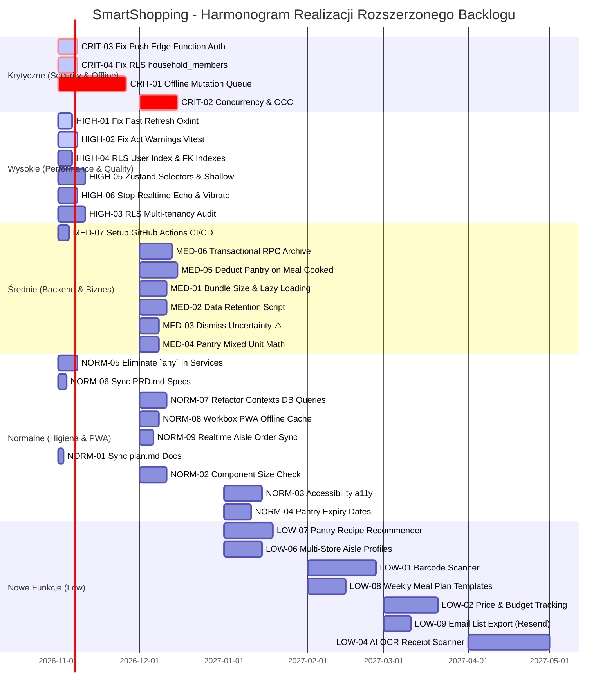

# SmartShopping - Kompleksowa Mapa Drogowa (Roadmap & Backlog)

> **Status dokumentu:** Aktywny / Żywy backlog techniczno-biznesowy  
> **Data utworzenia:** Październik 2026  
> **Źródło:** Audyt całościowy kodu, architektury, testów, bezpieczeństwa oraz spójności z [PRD](./PRD.md) i [plan.md](./plan.md)  
> **Konstytucja projektu:** [AGENTS.md](../AGENTS.md) | [.agents/rules/](../.agents/rules/)

---

## 1. Wstęp i Metodologia Kategoryzacji

Niniejszy dokument stanowi jednolity rejestr zadań naprawczych, optymalizacyjnych oraz rozwojowych dla aplikacji **SmartShopping**. Zgłoszenia zostały podzielone na 5 ustandaryzowanych kategorii priorytetu:

| Poziom Priorytetu | Znaczenie i Kryteria Kwalifikacji |
| :--- | :--- |
| 🔴 **Critical** | Błędy krytyczne, ryzyko utraty danych (np. utrata odhaczeń w markecie offline), dziury w bezpieczeństwie, awarie blokujące kluczowe procesy użytkownika. |
| 🟠 **High** | Istotne długi techniczne, błędy lintera psujące dewelopment (Fast Refresh), wycieki w testach (`act(...)`), weryfikacja szczelności RLS i multi-tenancy. |
| 🟡 **Medium** | Optymalizacje wydajności (Bundle Size / Code Splitting), higiena bazy danych (retencja danych w Supabase), istotne usprawnienia UX/biznesowe (np. wyciszanie niepewności w kalendarzu). |
| 🟢 **Normal** | Standardowe ulepszenia jakościowe: czyszczenie dokumentacji, dbałość o rozmiar komponentów (<250-300 linii), podstawy dostępności cyfrowej (a11y/WCAG), rozszerzenia spiżarni. |
| 🔵 **Low** | Nowe innowacyjne moduły i funkcjonalności (Skaner kodów kreskowych, śledzenie cen i budżetu, AI OCR paragonów, tryb gościa, aplikacje na zegarki). |

---

## 2. 🔴 Kategoria CRITICAL (Najwyższy Priorytet)

### CRIT-01: Offline Mutation Queue & Background Sync w Markecie (Zero-Connectivity Resilience)
* **Obszar:** Frontend / State Management (`Zustand`, `PWA Service Worker`)
* **Pliki:** [useShoppingStore.ts](file:///d:/08_Git/SmartShopping/SmartShopping/src/store/useShoppingStore.ts), [shoppingListService.ts](file:///d:/08_Git/SmartShopping/SmartShopping/src/services/shoppingListService.ts)
* **Problem / Uzasadnienie:**
  * W supermarketach i podziemnych halach zasięg sieci komórkowej ulega częstemu zerwaniu.
  * Obecny mechanizm w [useShoppingStore.ts](file:///d:/08_Git/SmartShopping/SmartShopping/src/store/useShoppingStore.ts) przy odhaczaniu (`toggleItemCheck`) stosuje Optimistic UI, lecz przy błędzie sieciowym natychmiast wywołuje `rollbackState()`.
  * Skutek: Użytkownik odhacza 5-10 kupionych artykułów, po czym z powodu utraty łączności aplikacja cofa zaznaczenia, wywołując dezorientację i powtórne zakupy.
* **Proponowane Rozwiązanie:**
  1. Wprowadzenie lokalnej kolejki mutacji offline (**Offline Mutation Queue**) opartej o `IndexedDB` lub `localStorage`.
  2. W przypadku błędu zapytania sieciowego stan w UI **nie jest natychmiast wycofywany**. Zadanie trafia do kolejki ze statusem `pending_sync`.
  3. Rejestracja nasłuchiwania zdarzeń `window.addEventListener('online')` oraz integracja z Background Sync Service Workera w PWA.
  4. Po powrocie połączenia kolejka jest sekwencyjnie opróżniana z mechanizmem retry (exponential backoff).
* **Definition of Done (DoD):**
  - Wyłączenie sieci (Chrome DevTools: Offline) i odhaczenie 10 pozycji nie powoduje rollbacku.
  - Włączenie sieci automatycznie przesyła mutacje do Supabase bez odświeżania strony.
  - Pokrycie testami integracyjnymi symulującymi awarię sieci w `useShoppingStore.test.ts`.

---

### CRIT-02: Optymistyczna Kontrola Współbieżności i Rozwiązywanie Konfliktów Realtime (OCC)
* **Obszar:** Backend / Baza Danych / Realtime
* **Pliki:** [shoppingListService.ts](file:///d:/08_Git/SmartShopping/SmartShopping/src/services/shoppingListService.ts), [20260822000000_enable_rls_and_security_policies.sql](file:///d:/08_Git/SmartShopping/SmartShopping/supabase/migrations/20260822000000_enable_rls_and_security_policies.sql)
* **Problem / Uzasadnienie:**
  * Gdy dwóch domowników robi zakupy jednocześnie w różnych alejkach lub jeden edytuje listę w domu, a drugi odhacza w sklepie, może dojść do sytuacji Last-Write-Wins bez walidacji znacznika czasu.
  * Zdarzenie WebSocket z opóźnionego telefonu może nadpisać nowszy stan pozycji na serwerze.
* **Proponowane Rozwiązanie:**
  1. Dodanie kolumny `updated_at TIMESTAMPTZ DEFAULT NOW()` do `shopping_list_items`.
  2. Przy aktualizacjach warunkowych egzekwowanie klauzuli `WHERE id = ... AND updated_at <= client_timestamp`.
  3. W przypadku wykrycia konfliktu serwerowego: automatyczne scalanie z preferencją stanu `is_checked = true` (jeśli którykolwiek z partnerów kupił produkt, uznaje się go za kupiony).
* **Definition of Done (DoD):**
  - Brak utraty stanu odhaczenia przy symulacji opóźnionego pakietu WebSocket z drugiego urządzenia.

---

### CRIT-03: Zabezpieczenie Edge Function Powiadomień Push (Weryfikacja Przynależności do Household)
* **Obszar:** Backend / Bezpieczeństwo / Supabase Edge Functions
* **Pliki:** [send-push-notification/index.ts](file:///d:/08_Git/SmartShopping/SmartShopping/supabase/functions/send-push-notification/index.ts)
* **Problem / Uzasadnienie:**
  * W funkcji [send-push-notification/index.ts](file:///d:/08_Git/SmartShopping/SmartShopping/supabase/functions/send-push-notification/index.ts#L43-L75) weryfikowany jest jedynie ogólny token użytkownika (`userClient.auth.getUser()`).
  * Następnie funkcja wykonuje zapytanie do tabeli `push_subscriptions` z użyciem `supabaseServiceRoleKey` (omijającego RLS) wyłącznie po wartości `householdId` przekazanej w body JSON.
  * **Luka:** Dowolny zalogowany użytkownik aplikacji może spreparować zapytanie POST z `householdId` obcego gospodarstwa domowego i rozesłać powiadomienia push o dowolnej treści na urządzenia obcych osób bez posiadania jakichkolwiek uprawnień do tego gospodarstwa.
* **Proponowane Rozwiązanie:**
  1. Dodanie weryfikacji członkostwa wywołującego użytkownika przed pobraniem subskrypcji:
     ```typescript
     const { data: member } = await supabaseClient
       .from('household_members')
       .select('id')
       .eq('household_id', householdId)
       .eq('user_id', user.id)
       .maybeSingle()
     if (!member) {
       return new Response(JSON.stringify({ error: "Forbidden: You are not a member of this household" }), {
         status: 403,
         headers: { ...corsHeaders, "Content-Type": "application/json" }
       })
     }
     ```
* **Definition of Done (DoD):**
  - Próba wysłania powiadomienia z poprawnym tokenem JWT użytkownika A do gospodarstwa B (w którym A nie jest członkiem) zwraca status HTTP 403 Forbidden.
  - Pokrycie testem automatycznym Edge Function lub testem integracyjnym.

---

### CRIT-04: Uszczelnienie Polityki RLS w `household_members` (Blokada Samowolnego Dołączania do Gospodarstw)
* **Obszar:** Baza Danych / Bezpieczeństwo / Supabase RLS
* **Pliki:** [20260822000000_enable_rls_and_security_policies.sql](file:///d:/08_Git/SmartShopping/SmartShopping/supabase/migrations/20260822000000_enable_rls_and_security_policies.sql), [householdService.ts](file:///d:/08_Git/SmartShopping/SmartShopping/src/services/householdService.ts)
* **Problem / Uzasadnienie:**
  * W migracji RLS polityka `INSERT` dla tabeli `household_members` została zdefiniowana następująco:
    ```sql
    WITH CHECK (
      user_id = auth.uid()
      OR household_id IN (SELECT public.get_user_household_ids(auth.uid()))
    );
    ```
  * Ponieważ warunek `user_id = auth.uid()` jest zawsze prawdziwy dla rekordu wstawianego przez zalogowanego użytkownika dla samego siebie, **dowolny użytkownik znający UUID obcego gospodarstwa może bezpośrednio wykonać `INSERT INTO household_members` i dołączyć do obcego gospodarstwa bez zaproszenia**.
  * Po dołączeniu funkcja `get_user_household_ids` natychmiast przyznaje użytkownikowi pełny dostęp odczytu, modyfikacji i usuwania przepisów, list zakupowych, pozycji spiżarni i profili domowników tego gospodarstwa.
* **Proponowane Rozwiązanie:**
  1. Usunięcie swobodnego warunku `user_id = auth.uid()` z polityki `INSERT`.
  2. Dozwolenie na dodanie członka do istniejącego gospodarstwa wyłącznie gdy:
     - Wykonuje to istniejący członek gospodarstwa: `household_id IN (SELECT public.get_user_household_ids(auth.uid()))`, LUB
     - Użytkownik posiada aktywne, oczekujące zaproszenie w `household_invites` dopasowane do swojego adresu e-mail (`lower(email) = lower(auth.jwt() ->> 'email')`).
  3. Tworzenie nowego gospodarstwa i przypisanie pierwszego członka (twórcy) przenieść do bezpiecznej funkcji PostgreSQL `create_household(name TEXT)` z klauzulą `SECURITY DEFINER`.
* **Definition of Done (DoD):**
  - Próba bezpośredniego dodania rekordu do `household_members` dla obcego gospodarstwa bez istniejącego zaproszenia jest odrzucana przez RLS (błąd uprawnień).
  - Prawidłowe dołączanie przez zaakceptowane zaproszenie e-mail oraz tworzenie nowego gospodarstwa działają bez zakłóceń.

---

## 3. 🟠 Kategoria HIGH (Wysoki Priorytet)

### HIGH-01: Likwidacja Ostrzeżeń Fast Refresh w Linterze (`oxlint`)
* **Obszar:** Frontend / Tooling / Developer Experience
* **Pliki:** [button.tsx](file:///d:/08_Git/SmartShopping/SmartShopping/src/components/ui/button.tsx), [badge.tsx](file:///d:/08_Git/SmartShopping/SmartShopping/src/components/ui/badge.tsx), [AuthContext.tsx](file:///d:/08_Git/SmartShopping/SmartShopping/src/context/AuthContext.tsx)
* **Problem / Uzasadnienie:**
  * Linter `oxlint` zwraca 3 ostrzeżenia reguły `react(only-export-components)`:
    - `src/components/ui/button.tsx`: eksport komponentu `Button` i obiektu `buttonVariants`.
    - `src/components/ui/badge.tsx`: eksport komponentu `Badge` i obiektu `badgeVariants`.
    - `src/context/AuthContext.tsx`: eksport `AuthProvider` i hooka `useAuth`.
  * Skutek: Naruszenie mechanizmu React Hot Module Replacement (HMR). Przy edycji tych plików w trakcie pracy cały stan aplikacji ulega zresetowaniu zamiast szybkiego odświeżenia.
* **Proponowane Rozwiązanie:**
  1. Wydzielenie definicji wariantów stylów CVA do dedykowanych plików, np. `src/components/ui/button.variants.ts` oraz `src/components/ui/badge.variants.ts`.
  2. Wydzielenie hooka `useAuth` do dedykowanego pliku `src/hooks/useAuth.ts`.
* **Definition of Done (DoD):**
  - Polecenie `npm run lint` wykonuje się z wynikiem `0 warnings and 0 errors`.

---

### HIGH-02: Eliminacja Ostrzeżeń `act(...)` w Środowisku Testowym Vitest
* **Obszar:** Testy Automatyczne / Vitest
* **Pliki:** [CalendarView.test.tsx](file:///d:/08_Git/SmartShopping/SmartShopping/src/components/views/__tests__/CalendarView.test.tsx), [AddMealSheet.test.tsx](file:///d:/08_Git/SmartShopping/SmartShopping/src/components/dialogs/__tests__/AddMealSheet.test.tsx)
* **Problem / Uzasadnienie:**
  * Podczas uruchamiania `npm run test` w konsoli pojawiają się liczne ostrzeżenia: `An update to CalendarView inside a test was not wrapped in act(...)` oraz `An update to AddCalendarMealDialog inside a test was not wrapped in act(...)`.
  * Skutek: Asynchroniczne aktualizacje stanu Zustand w testach nie są poprawnie spłukiwane (flushed), co spowalnia działanie testów (obecnie ~38 sekund) i grozi tzw. "flaky tests" na maszynach CI/CD.
* **Proponowane Rozwiązanie:**
  1. Prawidłowe użycie `await waitFor(() => ...)` przy asynchronicznych akcjach otwierania/zamykania arkuszy i dialogów.
  2. Owinięcie asynchronicznych dispatchy ze store'a w `act(async () => ...)`.
  3. Upewnienie się, że mocki timerów (`vi.useFakeTimers()`) i czyszczenie subskrypcji w `afterEach` są poprawnie zadeklarowane.
* **Definition of Done (DoD):**
  - Uruchomienie `npm run test` przechodzi bez żadnych komunikatów na strumieniu `stderr` dotyczących `act(...)`.

---

### HIGH-03: RLS Security Audit & Household Multi-Tenancy Cross-Leakage Tests
* **Obszar:** Bezpieczeństwo / Supabase RLS
* **Pliki:** [20261007000000_add_calendar_meal_plans.sql](file:///d:/08_Git/SmartShopping/SmartShopping/supabase/migrations/20261007000000_add_calendar_meal_plans.sql), [20260901000000_add_pantry_module.sql](file:///d:/08_Git/SmartShopping/SmartShopping/supabase/migrations/20260901000000_add_pantry_module.sql)
* **Problem / Uzasadnienie:**
  * Nowe moduły (`meal_plans`, `pantry_items`, `push_subscriptions`) korzystają z polityk opartych o `get_user_household_ids(auth.uid())`.
  * Brakuje automatycznego testu weryfikującego, czy użytkownik A należący do gospodarstwa H1 może w jakichkolwiek warunkach odczytać, zmodyfikować lub usunąć rekordy gospodarstwa H2 (np. poprzez bezpośrednie zapytanie z podmienionym ID).
* **Proponowane Rozwiązanie:**
  1. Stworzenie zestawu testów bezpieczeństwa (np. test integracyjny API z dwoma różnymi tokenami JWT z różnych gospodarstw).
  2. Weryfikacja klauzul `WITH CHECK` we wszystkich politykach `INSERT` i `UPDATE`.
* **Definition of Done (DoD):**
  - Dedykowany test bezpieczeństwa weryfikujący brak wycieku danych między gospodarstwami kończy się powodzeniem (100% odmów dostępu 403/pusty wynik).

---

### HIGH-04: Indeksowanie Bazy Danych pod Funkcję RLS `get_user_household_ids` i Klucze Obce
* **Obszar:** Baza Danych / Wydajność / Indeksy PostgreSQL
* **Pliki:** [20260814000000_household_and_user_enhancements.sql](file:///d:/08_Git/SmartShopping/SmartShopping/supabase/migrations/20260814000000_household_and_user_enhancements.sql), [20260812220820_init_schema.sql](file:///d:/08_Git/SmartShopping/SmartShopping/supabase/migrations/20260812220820_init_schema.sql)
* **Problem / Uzasadnienie:**
  * W tabeli `household_members` istnieje klucz unikalny `CONSTRAINT unique_household_member UNIQUE (household_id, user_id)`. Tworzy on indeks kompozytowy z wiodącą kolumną `household_id`.
  * Funkcja pomocnicza RLS `public.get_user_household_ids(user_uuid UUID)` wykonuje zapytanie:
    ```sql
    SELECT household_id FROM public.household_members WHERE user_id = user_uuid;
    ```
  * W PostgreSQL indeks z `household_id` jako pierwszym polem nie może być optymalnie wykorzystany dla warunku `WHERE user_id = ...`.
  * Ponieważ funkcja ta jest ewaluowana dla niemal każdego wiersza w każdej tabeli objętej RLS (`meals`, `products`, `shopping_lists`, `pantry_items`, `meal_plans`), brak indeksu wiodącego po `user_id` skutkuje sekwencyjnym przeszukiwaniem i spowolnieniem każdego zapytania w aplikacji.
  * Dodatkowo klucze obce nie posiadają dedykowanych indeksów B-tree: `meal_ingredients(meal_id)`, `meal_ingredients(product_id)`, `meals(household_id)`, `products(household_id)`.
* **Proponowane Rozwiązanie:**
  1. Przygotowanie nowej migracji SQL dodającej indeksy wydajnościowe:
     ```sql
     CREATE INDEX IF NOT EXISTS idx_household_members_user_id ON public.household_members(user_id);
     CREATE INDEX IF NOT EXISTS idx_meal_ingredients_meal_id ON public.meal_ingredients(meal_id);
     CREATE INDEX IF NOT EXISTS idx_meal_ingredients_product_id ON public.meal_ingredients(product_id);
     CREATE INDEX IF NOT EXISTS idx_meals_household_id ON public.meals(household_id);
     CREATE INDEX IF NOT EXISTS idx_products_household_id ON public.products(household_id);
     ```
* **Definition of Done (DoD):**
  - Wykonanie `EXPLAIN ANALYZE` dla zapytania w `get_user_household_ids` wykazuje `Index Scan using idx_household_members_user_id` o stałym czasie O(1).
  - Wdrożenie migracji SQL do katalogu `supabase/migrations/`.

---

### HIGH-05: Eliminacja Kaskadowych Przerenderowań Zustand (Selektory i `useShallow`)
* **Obszar:** Frontend / Wydajność / React Rendering
* **Pliki:** [ActiveListView.tsx](file:///d:/08_Git/SmartShopping/SmartShopping/src/components/views/ActiveListView.tsx), [DesktopActiveListView.tsx](file:///d:/08_Git/SmartShopping/SmartShopping/src/components/layout/desktop/views/DesktopActiveListView.tsx), [DraftView.tsx](file:///d:/08_Git/SmartShopping/SmartShopping/src/components/views/DraftView.tsx), [CookbookView.tsx](file:///d:/08_Git/SmartShopping/SmartShopping/src/components/views/CookbookView.tsx), [ProductsView.tsx](file:///d:/08_Git/SmartShopping/SmartShopping/src/components/views/ProductsView.tsx), [CalendarView.tsx](file:///d:/08_Git/SmartShopping/SmartShopping/src/components/views/CalendarView.tsx), [AppLayoutRouter.tsx](file:///d:/08_Git/SmartShopping/SmartShopping/src/components/layout/AppLayoutRouter.tsx)
* **Problem / Uzasadnienie:**
  * W większości widoków i podkomponentów stan ze sklepów Zustand pobierany jest przez bezpośrednią destrukturyzację bez selektora, np.:
    ```typescript
    const { draftItems } = useShoppingStore()
    const { pantryMapByProductId } = usePantryStore()
    ```
  * W bibliotece Zustand wywołanie hooka bez selektora subskrybuje komponent na **jakąkolwiek** zmianę w całym obiekcie stanu (np. zmiana `selectedActiveListId`, `isSyncing`, modyfikacja dowolnego artykułu w spiżarni czy aktualizacja podsumowania list).
  * Skutek: Odhaczenie jednej pozycji na liście w markecie wywołuje natychmiastowe kaskadowe przerenderowanie kilkunastu ciężkich widoków w tle, powodując mikrozacięcia (jank) animacji i steperów na telefonach.
* **Proponowane Rozwiązanie:**
  1. Wprowadzenie selektorów atomowych:
     ```typescript
     const draftItems = useShoppingStore((state) => state.draftItems)
     const pantryMapByProductId = usePantryStore((state) => state.pantryMapByProductId)
     ```
  2. W przypadku pobierania wielu pól jednocześnie użycie hooka `useShallow` z `zustand/react/shallow`.
* **Definition of Done (DoD):**
  - Profiler React DevTools wykazuje spadek zbędnych renderów komponentów tła o min. 70% podczas interakcji z listą zakupów i spiżarnią.

---

### HIGH-06: Eliminacja Realtime Echo i Podwójnej Wibracji przy Odhaczaniu Pozycji
* **Obszar:** Frontend / Realtime / UX
* **Pliki:** [ActiveListView.tsx](file:///d:/08_Git/SmartShopping/SmartShopping/src/components/views/ActiveListView.tsx), [DesktopActiveListView.tsx](file:///d:/08_Git/SmartShopping/SmartShopping/src/components/layout/desktop/views/DesktopActiveListView.tsx), [useActiveListRealtime.ts](file:///d:/08_Git/SmartShopping/SmartShopping/src/hooks/useActiveListRealtime.ts)
* **Problem / Uzasadnienie:**
  * Gdy użytkownik zaznacza checkbox artykułu, interfejs wykonuje natychmiastową wibrację haptic i aktualizację optymistyczną, po czym wysyła żądanie do Supabase.
  * Serwer Supabase emituje zdarzenie WebSocket `UPDATE on shopping_list_items`, które wraca do tego samego urządzenia (klienta nadawcy).
  * Hook [useActiveListRealtime.ts](file:///d:/08_Git/SmartShopping/SmartShopping/src/hooks/useActiveListRealtime.ts#L33-L41) przy odebraniu zdarzenia wywołuje **drugą wibrację telefonu** (`navigator.vibrate([25, 40, 25])`) oraz zleca **dwa pełne zapytania sieciowe** (`getActiveListsSummary` i `getListWithDetails`).
  * Na wolnym łączu mobilnym w markecie powoduje to zjawisko "podskakiwania" listy oraz zbędny transfer danych.
* **Proponowane Rozwiązanie:**
  1. Dołączanie unikalnego identyfikatora klienta (`clientId`) do lokalnych mutacji lub śledzenie ostatnio modyfikowanych `itemId` z oknem czasowym (debouncing 1500ms).
  2. Wykluczenie ponownej wibracji na urządzeniu, które samo zainicjowało zmianę stanu checkboxa.
  3. Aplikowanie pojedynczego diffa w stanie listy (`activeList.items`) zamiast ponownego pobierania całej struktury relacyjnej z bazy przy każdym odhaczeniu.
* **Definition of Done (DoD):**
  - Kliknięcie checkboxa przez użytkownika wywołuje dokładnie 1 impuls wibracyjny.
  - Odhaczenie pozycji nie wyzwala ponownego pobierania `getListWithDetails` dla urządzenia nadawcy.

---

## 4. 🟡 Kategoria MEDIUM (Średni Priorytet)

### MED-01: Optymalizacja Wielkości Paczki (Bundle Size) i Lazy Loading Ciężkich Modułów
* **Obszar:** Frontend / Wydajność / PWA
* **Pliki:** [AppLayoutRouter.tsx](file:///d:/08_Git/SmartShopping/SmartShopping/src/components/layout/AppLayoutRouter.tsx), [DesktopLayout.tsx](file:///d:/08_Git/SmartShopping/SmartShopping/src/components/layout/desktop/DesktopLayout.tsx), [JsonRecipeImportDialog.tsx](file:///d:/08_Git/SmartShopping/SmartShopping/src/components/dialogs/JsonRecipeImportDialog.tsx)
* **Problem / Uzasadnienie:**
  * Moduły takie jak `JsonRecipeImportDialog` (skrót Ctrl+Alt+P), rozbudowany kalendarz (`DesktopCalendarView`, `CalendarView`) oraz edytor alejek sklepowych są kompilowane w głównym bundle startowym.
  * Zwiększa to początkowy czas ładowania (FCP/LCP) na słabszych urządzeniach mobilnych.
* **Proponowane Rozwiązanie:**
  1. Zastosowanie `React.lazy()` oraz `Suspense` dla komponentów dialogów, które nie są widoczne przy pierwszym załadowaniu:
     - `JsonRecipeImportDialog`
     - `CategoryManagerDialog` / `CategoryManagerSheet`
     - Podwidoki kalendarza (`MonthCalendarGrid`, `WeekCalendarView`)
* **Definition of Done (DoD):**
  - Główny plik JS aplikacji zmniejsza wagę o min. 20-30%, a dialogi są pobierane w dedykowanych chunkach dopiero w momencie otwarcia.

---

### MED-02: Mechanizm Retencji i Archiwizacji Starych Pozycji List Zakupowych
* **Obszar:** Baza Danych / Supabase Performance
* **Pliki:** [shopping_lists](file:///d:/08_Git/SmartShopping/SmartShopping/docs/PRD.md#L103-L115), [shopping_list_items](file:///d:/08_Git/SmartShopping/SmartShopping/docs/PRD.md#L117-L126)
* **Problem / Uzasadnienie:**
  * Każda zarchiwizowana lista zakupów pozostawia w bazie dziesiątki wierszy `shopping_list_items`.
  * Po roku aktywnego użytkowania baza gospodarstwa może zawierać dziesiątki tysięcy rekordów, spowalniając zapytania relacyjne i obciążając darmowy limit Supabase.
* **Proponowane Rozwiązanie:**
  1. Opracowanie funkcji w bazie PostgreSQL (lub Edge Function wywoływanej przez cron), która:
     - Pozostawia nagłówki zarchiwizowanych list (`shopping_lists`) dla celów statystycznych.
     - Kompresuje lub przenosi pozycje starsze niż 12 miesięcy do tabeli archiwalnej `shopping_list_items_archive` lub generuje z nich zagregowany snapshot JSON w nagłówku listy.
* **Definition of Done (DoD):**
  - Skrypt migracyjny z procedurą czyszczącą oraz możliwość uruchomienia zadania cron w Supabase.

---

### MED-03: Opcja Ignorowania / Wyciszania Niepewności w Kalendarzu (Acknowledge Uncertainty ⚠️)
* **Obszar:** Biznes / UX / Kalendarz Posiłków (ADR-009)
* **Pliki:** [UncertaintyWarningModal.tsx](file:///d:/08_Git/SmartShopping/SmartShopping/src/components/calendar/UncertaintyWarningModal.tsx), [calendarStatus.ts](file:///d:/08_Git/SmartShopping/SmartShopping/src/lib/calculations/calendarStatus.ts)
* **Problem / Uzasadnienie:**
  * Wskaźnik niepewności (⚠️) pojawia się za każdym razem, gdy składnika dania brakuje w spiżarni lub na liście.
  * Jeśli użytkownik świadomie decyduje się pominąć składnik (np. ma zamiennik w lodówce lub zje posiłek na mieście), ostrzeżenie pozostaje widoczne na stałe, wprowadzając szum wizualny.
* **Proponowane Rozwiązanie:**
  1. Dodanie przycisku *"Zrozumiałem / Ignoruj brak"* w oknie [UncertaintyWarningModal.tsx](file:///d:/08_Git/SmartShopping/SmartShopping/src/components/calendar/UncertaintyWarningModal.tsx).
  2. Zapis flagi `is_uncertainty_dismissed: boolean` w obiekcie planu posiłku (`meal_plans`).
  3. Wyczyszczenie wskaźnika ⚠️ po zatwierdzeniu przez użytkownika.
* **Definition of Done (DoD):**
  - Użytkownik może wyciszyć ostrzeżenie dla danego posiłku bez konieczności sztucznego wrzucania produktu do koszyka.

---

### MED-04: Inteligentne Przeliczanie Jednostek przy Częściowym Pokryciu ze Spiżarni
* **Obszar:** Czyste Kalkulacje / Logika Biznesowa
* **Pliki:** [pantryCalculations.ts](file:///d:/08_Git/SmartShopping/SmartShopping/src/lib/calculations/pantryCalculations.ts), [PantryConfirmModal.tsx](file:///d:/08_Git/SmartShopping/SmartShopping/src/components/dialogs/PantryConfirmModal.tsx)
* **Problem / Uzasadnienie:**
  * Jeśli przepis wymaga np. 1 kg mąki, a w spiżarni zapisane jest 400 g, funkcja kalkulacji delty musi bezbłędnie przeliczyć jednostki wagowe/objętościowe (`kg` <-> `g`, `l` <-> `ml`).
  * Obecnie kalkulacja delty działa najlepiej na identycznych jednostkach.
* **Proponowane Rozwiązanie:**
  1. Rozbudowa [pantryCalculations.ts](file:///d:/08_Git/SmartShopping/SmartShopping/src/lib/calculations/pantryCalculations.ts) o uniwersalny konwerter jednostek zgodnych typologicznie.
  2. Automatyczne sugerowanie brakującej ilości z zachowaniem jednostki bazowej produktu.
* **Definition of Done (DoD):**
  - 100% pokrycia testami przypadków mieszanych jednostek w `pantryCalculations.test.ts`.

---

### MED-05: Półautomatyczny / Automatyczny Rozchód Spiżarni po Realizacji Posiłku (Pantry Consumption)
* **Obszar:** Logika Biznesowa / Spiżarnia & Kalendarz (ADR-008 & ADR-009)
* **Pliki:** [pantryService.ts](file:///d:/08_Git/SmartShopping/SmartShopping/src/services/pantryService.ts), [DayCalendarView.tsx](file:///d:/08_Git/SmartShopping/SmartShopping/src/components/calendar/DayCalendarView.tsx), [MealDetailsSheet.tsx](file:///d:/08_Git/SmartShopping/SmartShopping/src/components/dialogs/MealDetailsSheet.tsx)
* **Problem / Uzasadnienie:**
  * W obecnej architekturze zamykanie listy zakupów automatycznie zasila stan spiżarni (`batchIngestPurchasedItems`).
  * Brakuje jednak procesu odwrotnego: gdy domownik ugotuje zaplanowany w kalendarzu obiad (np. "Kurczak w warzywach" wymagający 500g piersi z kurczaka i 2 papryk), stan magazynowy tych produktów w spiżarni **nie ulega pomniejszeniu**.
  * W efekcie bez żmudnego, ręcznego klikania minusów w zakładce Spiżarnia, stany posiadanych produktów rozjeżdżają się z rzeczywistością.
* **Proponowane Rozwiązanie:**
  1. Dodanie przycisku akcji *"Oznacz jako ugotowane / Zrealizuj posiłek"* w widoku dnia kalendarza oraz w szczegółach potrawy.
  2. Wyświetlenie zwięzłego modalu / Bottom Sheet z listą składników dania i propozycją odliczenia ich ze spiżarni (z checkboxami umożliwiającymi odznaczenie składników, których nie zużyto).
  3. Metoda `pantryService.deductMealIngredients(householdId, ingredients)` wykonująca pomniejszenie stanów magazynowych lub usunięcie pozycji o stanie <= 0.
* **Definition of Done (DoD):**
  - Użytkownik po ugotowaniu posiłku może jednym kliknięciem zdjąć proporcjonalną ilość składników ze spiżarni.
  - Testy jednostkowe weryfikujące poprawność redukcji ilości i usuwania wyczerpanych pozycji.

---

### MED-06: Transakcyjna Archiwizacja Listy w Bazie PostgreSQL (Procedura RPC)
* **Obszar:** Backend / Spójność Danych / PostgreSQL
* **Pliki:** [shoppingListService.ts](file:///d:/08_Git/SmartShopping/SmartShopping/src/services/shoppingListService.ts), nowa migracja SQL
* **Problem / Uzasadnienie:**
  * Metoda [archiveActiveList](file:///d:/08_Git/SmartShopping/SmartShopping/src/services/shoppingListService.ts#L610) wykonuje sekwencję 4 niezależnych zapytań z poziomu klienta przeglądarki:
    1. Aktualizacja statusu listy na `archived`.
    2. Wysłanie powiadomienia push.
    3. Pętla sekwencyjna `for ... await this.addOrIncrementItem` pobierająca i aktualizująca pozycje w spiżarni (do 50 zapytań HTTP!).
    4. Zapytanie pobierające nieodhaczone artykuły.
  * Jeśli podczas zamykania listy telefon straci połączenie w połowie pętli (np. w podziemnym garażu po zakupach), lista zostanie oznaczona jako archiwalna, ale spiżarnia zostanie zasilona tylko w połowie, a transakcja nie zostanie wycofana.
* **Proponowane Rozwiązanie:**
  1. Utworzenie procedury składowanej PostgreSQL `public.archive_shopping_list(p_list_id UUID, p_household_id UUID)`:
     - W pojedynczej transakcji atomowej `BEGIN ... COMMIT`:
       - Aktualizuje status listy na `archived` i ustawia `completed_at`.
       - Wykonuje `INSERT INTO pantry_items ... ON CONFLICT (household_id, product_id) DO UPDATE SET quantity = pantry_items.quantity + EXCLUDED.quantity` dla kupionych pozycji (`is_checked = true AND in_pantry = false`).
       - Zwraca rekordy nieodhaczone.
  2. Zredukowanie metody klienckiej w `shoppingListService.ts` do pojedynczego wywołania `supabase.rpc('archive_shopping_list')`.
* **Definition of Done (DoD):**
  - Cała operacja archiwizacji i zasilenia spiżarni wykonuje się w pojedynczym zapytaniu sieciowym <100ms.
  - Gwarancja braku niespójności danych przy zerwaniu połączenia.

---

### MED-07: Zautomatyzowany Pipeline CI/CD (GitHub Actions)
* **Obszar:** Narzędzia / DevOps / Jakość Kodu
* **Pliki:** `.github/workflows/ci.yml` (nowy plik)
* **Problem / Uzasadnienie:**
  * W repozytorium brak konfiguracji CI/CD (katalog `.github` nie istnieje).
  * Cała weryfikacja jakościowa (274 testy Vitest, linter oxlint, typecheck `tsc -b`) spoczywa wyłącznie na manualnym uruchomieniu przez programistę przed commitem.
  * Ryzyko przypadkowego wprowadzenia regresji, błędu typowania lub niedziałającego testu do gałęzi `main`.
* **Proponowane Rozwiązanie:**
  1. Utworzenie pliku workflow `.github/workflows/ci.yml` uruchamianego na `push` i `pull_request` dla gałęzi `main`.
  2. Krokowe uruchamianie:
     - `npm ci`
     - `npm run lint` (oxlint)
     - `npx tsc -b` (strict TypeScript check)
     - `npm run test` (vitest run)
* **Definition of Done (DoD):**
  - Każdy Pull Request oraz push do gałęzi `main` jest automatycznie testowany na maszynie GitHub Actions z zielonym statusem.

---

## 5. 🟢 Kategoria NORMAL (Standardowy Priorytet)

### NORM-01: Aktualizacja Dokumentacji Statusu Fazy 15 w `docs/plan.md`
* **Obszar:** Dokumentacja / Spójność Projektu
* **Pliki:** [plan.md](file:///d:/08_Git/SmartShopping/SmartShopping/docs/plan.md#L319)
* **Problem / Uzasadnienie:**
  * Nagłówek Fazy 15 w `docs/plan.md` nie posiada oznaczenia `(Zakończona w całości)`, w przeciwieństwie do pozostałych ukończonych faz, mimo że cały moduł kalendarza wraz z testami i widokami został wdrożony.
* **Proponowane Rozwiązanie:**
  - Oznaczenie Fazy 15 jako zakończonej w [plan.md](file:///d:/08_Git/SmartShopping/SmartShopping/docs/plan.md).
* **Definition of Done (DoD):**
  - Pełna spójność między `docs/PRD.md`, `docs/plan.md` a kodem źródłowym.

---

### NORM-02: Weryfikacja i Refaktoryzacja Modułowości Komponentów (< 250-300 Linii)
* **Obszar:** Frontend / Czystość Kodu (Zasada 2.4 z `AGENTS.md`)
* **Pliki:** [AddMealSheet.tsx](file:///d:/08_Git/SmartShopping/SmartShopping/src/components/dialogs/AddMealSheet.tsx), [ActiveListView.tsx](file:///d:/08_Git/SmartShopping/SmartShopping/src/components/views/ActiveListView.tsx), [CalendarView.tsx](file:///d:/08_Git/SmartShopping/SmartShopping/src/components/views/CalendarView.tsx)
* **Problem / Uzasadnienie:**
  * Niektóre widoki i arkusze rozrosły się wraz z nowymi wymaganiami (hierarchia produktów, integracja ze spiżarnią, obsługa niepewności), zbliżając się lub przekraczając 300 linii kodu.
* **Proponowane Rozwiązanie:**
  1. Wydzielenie pomniejszych sekcji UI (np. paski akcji, nagłówki sekcji, selektory makro) do dedykowanych komponentów w podkatalogach.
  2. Ekstrakcja logiki formularzy do dedykowanych hooków (np. `useMealForm`).
* **Definition of Done (DoD):**
  - Żaden plik komponentu nie przekracza 300 linii kodu bez uzasadnienia architektonicznego.

---

### NORM-03: Dostępność Cyfrowa (a11y / WCAG 2.1 AA) i Nawigacja Klawiaturą
* **Obszar:** Frontend / Dostępność / UX
* **Pliki:** [MonthCalendarGrid.tsx](file:///d:/08_Git/SmartShopping/SmartShopping/src/components/calendar/MonthCalendarGrid.tsx), [BottomNavigation.tsx](file:///d:/08_Git/SmartShopping/SmartShopping/src/components/layout/BottomNavigation.tsx)
* **Problem / Uzasadnienie:**
  * Zaawansowane komponenty dotykowe (kalendarz siatkowy, przeciąganie alejek, dynamiczne stepery) wymagają poprawnego wsparcia dla czytników ekranu (TalkBack, VoiceOver) oraz pełnej obsługi klawiaturą (Tab/Enter/Strzałki).
* **Proponowane Rozwiązanie:**
  1. Dodanie ról ARIA (`role="grid"`, `role="gridcell"`, `aria-selected`, `aria-current`).
  2. Sprawdzenie kontrastu kolorów dla wszystkich 6 motywów graficznych.
* **Definition of Done (DoD):**
  - Raport Lighthouse Accessibility na poziomie min. 95 punktów.

---

### NORM-04: Opcjonalne Daty Ważności w Module Spiżarni (Expiry Date Tracking)
* **Obszar:** Baza Danych / Spiżarnia (ADR-008)
* **Pliki:** [pantry_items](file:///d:/08_Git/SmartShopping/SmartShopping/docs/PRD.md#L128-L141), [PantryView.tsx](file:///d:/08_Git/SmartShopping/SmartShopping/src/components/views/PantryView.tsx)
* **Problem / Uzasadnienie:**
  * Obecnie świeżość w spiżarni jest szacowana algorytmicznie na podstawie daty ostatniego zakupu lub weryfikacji. Użytkownicy często chcą wprowadzić konkretną datę ważności (np. z opakowania mleka, mięsa).
* **Proponowane Rozwiązanie:**
  1. Dodanie kolumny `expiration_date DATE NULL` do tabeli `pantry_items`.
  2. Wskaźnik wizualny: czerwony badge *"Kończy się termin"* dla produktów z terminem < 48h.
* **Definition of Done (DoD):**
  - Pole wyboru daty w `AddPantryItemDialog` oraz sortowanie spiżarni wg terminu ważności.

---

### NORM-05: Likwidacja Typu `any` w Warstwie Serwisów Supabase (Strict Typing)
* **Obszar:** TypeScript / Jakość Kodu (Zasada 2.4 z `AGENTS.md`)
* **Pliki:** [shoppingListService.ts](file:///d:/08_Git/SmartShopping/SmartShopping/src/services/shoppingListService.ts), [mealPlanService.ts](file:///d:/08_Git/SmartShopping/SmartShopping/src/services/mealPlanService.ts), [mealService.ts](file:///d:/08_Git/SmartShopping/SmartShopping/src/services/mealService.ts), [householdService.ts](file:///d:/08_Git/SmartShopping/SmartShopping/src/services/householdService.ts)
* **Problem / Uzasadnienie:**
  * W serwisach integracji z Supabase występuje kilkanaście rzutowań typu `(data || []).map((row: any) => ...)` oraz `(item: any) => ...` przy przetwarzaniu relacyjnych odpowiedzi PostgREST (joinów).
  * Narusza to konstytucyjną zasadę *Zero Tolerance for `any`* z [AGENTS.md](file:///d:/08_Git/SmartShopping/SmartShopping/AGENTS.md#L45) i osłabia bezpieczeństwo refaktoryzacji schematu bazy danych.
* **Proponowane Rozwiązanie:**
  1. Zdefiniowanie typów relacyjnych w `src/types/` z wykorzystaniem narzędzia `QueryData<typeof query>` z biblioteki `@supabase/supabase-js`.
  2. Zastąpienie wszystkich rzutowań `any` precyzyjnymi interfejsami relacyjnymi.
* **Definition of Done (DoD):**
  - Wyszukiwanie `: any` w katalogu `src/services/` zwraca dokładnie 0 wyników.

---

### NORM-06: Usunięcie Driftu Dokumentacji w `docs/PRD.md` (React 19, Schemat DDL, Eksport E-mail)
* **Obszar:** Dokumentacja / Spójność Projektu
* **Pliki:** [PRD.md](file:///d:/08_Git/SmartShopping/SmartShopping/docs/PRD.md)
* **Problem / Uzasadnienie:**
  * W sekcji 2 [PRD.md](file:///d:/08_Git/SmartShopping/SmartShopping/docs/PRD.md#L11) nadal widnieje `React 18` i `React Query` zamiast `React 19` i `Zustand`.
  * Schemat DDL w sekcji 4 [PRD.md](file:///d:/08_Git/SmartShopping/SmartShopping/docs/PRD.md#L117-L126) dla `shopping_list_items` nie zawiera kolumny `meal_plan_item_id UUID` dodanej w migracji Fazy 15.
  * Funkcjonalność eksportu e-mail jest opisana w sekcji 5 PRD jako zrealizowana, podczas gdy w kodzie brak jej implementacji.
* **Proponowane Rozwiązanie:**
  1. Zaktualizowanie wersji frameworka do `React 19` w PRD.
  2. Uzupełnienie skryptu DDL o kolumnę `meal_plan_item_id`.
  3. Oznaczenie punktu eksportu e-mail jako funkcjonalności planowanej w backlogu (`Roadmap: LOW-09`).
* **Definition of Done (DoD):**
  - Dokument [PRD.md](file:///d:/08_Git/SmartShopping/SmartShopping/docs/PRD.md) odzwierciedla w 100% stan faktyczny bazy danych i stosu technologicznego.

---

### NORM-07: Wydzielenie Zapytań Supabase z `AuthContext` i `ThemeContext` do Warstwy Serwisów
* **Obszar:** Architektura / Separacja Warstw (Reguła 02 z `AGENTS.md`)
* **Pliki:** [AuthContext.tsx](file:///d:/08_Git/SmartShopping/SmartShopping/src/context/AuthContext.tsx), [ThemeContext.tsx](file:///d:/08_Git/SmartShopping/SmartShopping/src/theme/ThemeContext.tsx), [householdService.ts](file:///d:/08_Git/SmartShopping/SmartShopping/src/services/householdService.ts)
* **Problem / Uzasadnienie:**
  * [AuthContext.tsx](file:///d:/08_Git/SmartShopping/SmartShopping/src/context/AuthContext.tsx) rozrósł się do 480 linii i bezpośrednio wykonuje operacje CRUD na tabelach `users`, `household_invites` i `household_members`.
  * [ThemeContext.tsx](file:///d:/08_Git/SmartShopping/SmartShopping/src/theme/ThemeContext.tsx#L59-L65) bezpośrednio odpytuje `supabase.auth.getSession()` i wykonuje `.from('users').update({ theme })`.
  * Narusza to regułę [.agents/rules/02-state-services-realtime.md](file:///d:/08_Git/SmartShopping/SmartShopping/.agents/rules/02-state-services-realtime.md) zabraniającą bezpośredniego odpytywania bazy z warstwy UI i kontekstów.
* **Proponowane Rozwiązanie:**
  1. Przeniesienie metod synchronizacji profilu użytkownika i zaproszeń do [householdService.ts](file:///d:/08_Git/SmartShopping/SmartShopping/src/services/householdService.ts) lub dedykowanego serwisu `userService.ts`.
  2. Pozostawienie w kontekstach wyłącznie zarządzania reaktywnym stanem Reacta.
* **Definition of Done (DoD):**
  - Pliki `AuthContext.tsx` i `ThemeContext.tsx` nie importują bezpośrednio singletonu `@/lib/supabase`.
  - Rozmiar `AuthContext.tsx` spada poniżej 250 linii kodu.

---

### NORM-08: Konfiguracja Caching Offline w Service Workerze (Workbox PWA)
* **Obszar:** PWA / Wydajność / Offline First
* **Pliki:** [vite.config.ts](file:///d:/08_Git/SmartShopping/SmartShopping/vite.config.ts), [public/sw-push.js](file:///d:/08_Git/SmartShopping/SmartShopping/public/sw-push.js)
* **Problem / Uzasadnienie:**
  * W pliku [vite.config.ts](file:///d:/08_Git/SmartShopping/SmartShopping/vite.config.ts#L17-L19) plugin `VitePWA` posiada jedynie wpis `importScripts: ["sw-push.js"]`.
  * Brakuje reguł `runtimeCaching` dla fontów Google, ikon oraz stylów CSS, co w przypadku otwarcia aplikacji przy braku sieci w markecie może skutkować pustym ekranem lub brakiem ikon.
* **Proponowane Rozwiązanie:**
  1. Skonfigurowanie strategii `CacheFirst` dla fontów i ikon SVG.
  2. Skonfigurowanie strategii `StaleWhileRevalidate` dla arkuszy stylów i chunków JS.
* **Definition of Done (DoD):**
  - Aplikacja w trybie samolotowym (Offline) po jednokrotnym załadowaniu uruchamia się w pełni ostylowana wraz ze wszystkimi ikonami Lucide.

---

### NORM-09: Synchronizacja Realtime Układu Alejek w Widoku Aktywnej Listy
* **Obszar:** Realtime / UX / Zakupy w Gospodarstwie
* **Pliki:** [useCategoryStore.ts](file:///d:/08_Git/SmartShopping/SmartShopping/src/store/useCategoryStore.ts), [ActiveListView.tsx](file:///d:/08_Git/SmartShopping/SmartShopping/src/components/views/ActiveListView.tsx), [DesktopActiveListView.tsx](file:///d:/08_Git/SmartShopping/SmartShopping/src/components/layout/desktop/views/DesktopActiveListView.tsx)
* **Problem / Uzasadnienie:**
  * Zgodnie z [plan.md](file:///d:/08_Git/SmartShopping/SmartShopping/docs/plan.md#L180) kolejność alejek powinna synchronizować się na żywo między domownikami.
  * Obecnie metoda `subscribeRealtime` ze sklepu `useCategoryStore` jest wywoływana tylko wewnątrz otwartego modalu konfiguratora kategorii. Użytkownik robiący zakupy na ekranie aktywnej listy nie zobaczy nowej kolejności, dopóki nie odświeży strony.
* **Proponowane Rozwiązanie:**
  1. Podpięcie nasłuchiwania `subscribeRealtime` w widokach `ActiveListView` oraz `DesktopActiveListView` w cyklu życia komponentu.
* **Definition of Done (DoD):**
  - Zmiana kolejności alejek przez jednego domownika natychmiast przestawia grupy alejek na ekranie drugiego domownika bez konieczności przeładowania widoku.

---

## 6. 🔵 Kategoria LOW (Niski Priorytet / Nowe Funkcjonalności)

### LOW-01: Skaner Kodów Kreskowych (Barcode Scanner) w PWA
* **Obszar:** Innowacja / Mobile PWA / Kamera
* **Opis:**
  - Skanowanie kodów kreskowych (EAN-13 / UPC) z kamery telefonu w sklepie i spiżarni.
  - Wykorzystanie natywnego API przeglądarek `BarcodeDetector` z fallbackiem do biblioteki JavaScript.
  - Automatyczne wyszukiwanie produktu w katalogu lub otwarcie formularza szybkiego dodawania.

---

### LOW-02: Śledzenie Cen i Szacowanie Kosztu Zakupów (Price & Budget Tracking)
* **Obszar:** Finanse Domowe / Nowy Moduł
* **Opis:**
  - Opcjonalne pole ceny przy produktach (`last_price`, `estimated_unit_price`).
  - Dynamiczne podsumowanie szacowanego kosztu koszyka w widoku `DraftView` i `ActiveListView`.
  - Ostrzeganie o przekroczeniu zdefiniowanego limitu budżetowego gospodarstwa.

---

### LOW-03: Tryb Gościa / Udostępnianie Listy Zakupów Linkiem (Guest Share Mode)
* **Obszar:** Integracje / Bezpieczeństwo
* **Opis:**
  - Generowanie unikalnego, ograniczonego czasowo linku z tokenem dostępu (np. na 24h).
  - Umożliwienie osobie spoza gospodarstwa (sąsiad, kurier, rodzina) podejrzenia i odhaczenia listy w przeglądarce bez konieczności logowania kontem Google.

---

### LOW-04: Inteligentny Import Paragonów ze Zdjęcia (AI Vision / OCR)
* **Obszar:** AI / Automatyzacja
* **Opis:**
  - Zrobienie zdjęcia paragonu po powrocie ze sklepu.
  - Przetworzenie obrazu przez Edge Function z modelem multimodalnym (np. Gemini Vision).
  - Automatyczne rozpoznanie artykułów, przypisanie do kategorii i zasilenie modułu Spiżarni jednym kliknięciem.

---

### LOW-05: Mini Aplikacja Towarzysząca na Smartwatche (Wear OS / watchOS)
* **Obszar:** Wearables / Ekosystem
* **Opis:**
  - Bardzo prosty widok odhaczania listy zakupowej bezpośrednio z nadgarstka, aby nie wyciągać telefonu przy każdej alejce w markecie.

---

### LOW-06: Profile Sklepowe dla Układu Alejek (Biedronka / Lidl / Carrefour)
* **Obszar:** UX / Personalizacja Zakupów / Multi-Store
* **Pliki:** `household_category_settings`, [CategoryManagerContent.tsx](file:///d:/08_Git/SmartShopping/SmartShopping/src/components/categories/CategoryManagerContent.tsx), [ActiveListView.tsx](file:///d:/08_Git/SmartShopping/SmartShopping/src/components/views/ActiveListView.tsx)
* **Opis:**
  - W schemacie bazy danych w tabeli `household_category_settings` istnieje już przewidziane pole `store_profile_id UUID`.
  - Różne sieci sklepów mają diametralnie inny układ alejek (np. w Biedronce pieczywo i warzywa są na wejściu, w Lidlu owoce są pierwsze, a chemia na końcu).
  - Funkcjonalność umożliwia zdefiniowanie profili sklepowych (np. "Biedronka Osiedlowa", "Lidl Główny") i szybkie przełączanie aktywnego marketu z nagłówka listy zakupowej.

---

### LOW-07: Silnik Rekomendacji Przepisów na Bazie Zawartości Spiżarni ("Co dziś ugotować?")
* **Obszar:** Kulinaria / Nowy Moduł / Zero Waste
* **Pliki:** [CookbookView.tsx](file:///d:/08_Git/SmartShopping/SmartShopping/src/components/views/CookbookView.tsx), [DesktopCookbookView.tsx](file:///d:/08_Git/SmartShopping/SmartShopping/src/components/layout/desktop/views/DesktopCookbookView.tsx), [pantryCalculations.ts](file:///d:/08_Git/SmartShopping/SmartShopping/src/lib/calculations/pantryCalculations.ts)
* **Opis:**
  - Inteligentny filtr w Przepiśniku sortujący dania według dostępności składników w spiżarni gospodarstwa.
  - Zakładki: *"Gotowe do zrobienia (100% składników)"*, *"Brakuje 1 produktu"*, *"Wykorzystaj kończące się zapasy"*.
  - Eliminuje marnowanie żywności i podpowiada obiady bez konieczności wychodzenia do sklepu.

---

### LOW-08: Szablony i Powtarzalne Cykle Tygodniowe w Kalendarzu Posiłków
* **Obszar:** Planowanie / Kalendarz Posiłków (ADR-009)
* **Pliki:** [useMealPlanStore.ts](file:///d:/08_Git/SmartShopping/SmartShopping/src/store/useMealPlanStore.ts), [CalendarView.tsx](file:///d:/08_Git/SmartShopping/SmartShopping/src/components/views/CalendarView.tsx)
* **Opis:**
  - Możliwość zapisania całego skomponowanego tygodnia posiłków jako nazwanego szablonu (np. *"Tydzień redukcyjny 2200 kcal"*, *"Szybki tydzień pracujący"*).
  - Aplikowanie szablonu na dowolny przyszły tydzień w kalendarzu jednym kliknięciem, z automatycznym skalowaniem porcji pod domowników.

---

### LOW-09: Eksport Listy Zakupów na E-mail (Gmail / Resend)
* **Obszar:** Integracje / Udostępnianie
* **Pliki:** Supabase Edge Function, [ActiveListView.tsx](file:///d:/08_Git/SmartShopping/SmartShopping/src/components/views/ActiveListView.tsx), [DesktopActiveListView.tsx](file:///d:/08_Git/SmartShopping/SmartShopping/src/components/layout/desktop/views/DesktopActiveListView.tsx)
* **Opis:**
  - Przywrócenie planowanej w PRD funkcji wysyłki listy zakupowej na adres Gmail połączony z kontem.
  - Edge Function w Supabase generująca estetyczny, sformatowany szablon HTML listy zakupów podzielony według alejek sklepowych z polami wyboru i wysyłająca go przez API (np. Resend).

---

## 7. Podsumowanie i Matryca Realizacji



| ID Zadania | Kategoria | Moduł | Szacowany Czas | Kluczowa Korzyść |
| :--- | :--- | :--- | :--- | :--- |
| **CRIT-03** | 🔴 Critical | Security / Edge Functions | 1-2 dni | Eliminacja podatności podszywania się pod obce gospodarstwo w powiadomieniach push. |
| **CRIT-04** | 🔴 Critical | Security / Supabase RLS | 1-2 dni | Uniemożliwienie samowolnego dołączania użytkowników do cudzych gospodarstw. |
| **CRIT-01** | 🔴 Critical | Frontend / Offline PWA | 4-5 dni | Brak utraty odhaczonych artykułów przy braku zasięgu w halach marketów. |
| **CRIT-02** | 🔴 Critical | Backend / Realtime | 2-3 dni | Spójność równoległych zakupów dwóch domowników (Last-Write-Wins prevention). |
| **HIGH-04** | 🟠 High | Database / Indexes | 1 dzień | Błyskawiczna ewaluacja RLS `get_user_household_ids` w całej bazie danych. |
| **HIGH-05** | 🟠 High | Performance / React | 2 dni | Redukcja kaskadowych renderów o 70% dzięki selektorom Zustand i `useShallow`. |
| **HIGH-06** | 🟠 High | UX / Realtime | 1-2 dni | Usunięcie podwójnych wibracji telefonu i zbędnych zapytań GET przy każdym odhaczeniu. |
| **MED-05** | 🟡 Medium | Biznes / Spiżarnia | 3 dni | Automatyczne zdejmowanie składników ze spiżarni po ugotowaniu posiłku. |
| **MED-06** | 🟡 Medium | Database / RPC | 2 dni | Transakcyjne zamykanie listy i zasilanie spiżarni w 1 zapytaniu SQL. |
| **MED-07** | 🟡 Medium | DevOps / Tooling | 1 dzień | Automatyczna brama jakości CI/CD na GitHubie chroniąca przed regresjami. |
| **NORM-05** | 🟢 Normal | TypeScript Quality | 1-2 dni | Czyste, silne typowanie joinów PostgREST bez użycia typu `any`. |
| **NORM-06** | 🟢 Normal | Documentation | 0.5 dnia | Likwidacja driftu specyfikacji [PRD.md](file:///d:/08_Git/SmartShopping/SmartShopping/docs/PRD.md) z kodem. |
| **LOW-07** | 🔵 Low | New Feature / UX | 3-4 dni | Rekomendacje dań pod bieżące zapasy w lodówce ("Co dziś ugotować?"). |
| **LOW-06** | 🔵 Low | Multi-Store | 3 dni | Dedykowane układy alejek dopasowane do Biedronki, Lidla czy Carrefoura. |

> **Zalecana sekwencja wdrożeniowa:**  
> 1. Natychmiastowe załatanie luk bezpieczeństwa (`CRIT-03`, `CRIT-04`) oraz indeksowanie RLS (`HIGH-04`).  
> 2. Uporządkowanie narzędzi deweloperskich (`HIGH-01`, `HIGH-02`, `MED-07`).  
> 3. Wdrożenie odporności na brak łączności offline w markecie (`CRIT-01`, `HIGH-05`, `HIGH-06`).  
> 4. Transakcyjna archiwizacja i pętla rozchodu spiżarni (`MED-05`, `MED-06`).
