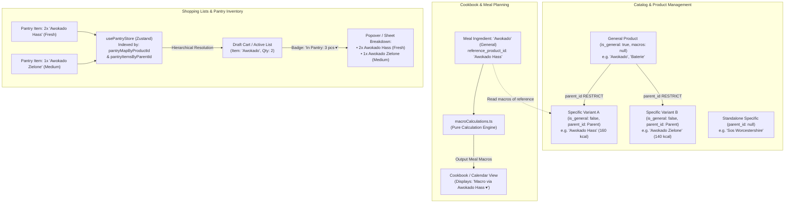

# ADR-010: Two-Level Hierarchical Product Catalog, Dynamic Nutrition Routing & Multi-Tier Pantry Intelligence

## 1. Metadata
- **Status:** Accepted
- **Date:** 2026-10-25
- **Decision Drivers:** 2-Level Product Hierarchy (General vs Specific), Recipe Nutrition Routing (`reference_product_id`), Dual Layout Indented Tree UX (Mobile PWA & Desktop), Hierarchical Pantry Inventory Synchronization, Relational Data Integrity (`ON DELETE RESTRICT`), Strict Multi-Tenant Supabase RLS.
- **Scope:** Full-Stack (PostgreSQL Schema, Constraints & RLS, Zustand State, Services, Pure Calculations, Mobile PWA Bottom Sheets & Desktop Dialogs)

---

## 2. Context & Problem Statement

SmartShopping currently treats all items in the catalog as specific, flat products (e.g. `Awokado Hass`, `Pomidory malinowe`, `Baterie alkaliczne AA 4-pak`, `Mleko 3.2%`). Each product has fixed macronutrient values (`kcal_per_100`, `protein_per_100`, `carbs_per_100`, `fat_per_100`) and a unit type (`g`, `ml`, `pcs`).

However, real-world household planning and grocery shopping operate on two distinct cognitive levels:
1. **General / High-Level Planning:** Users frequently plan meals or write grocery lists with generic requirements—for example, *"We need avocado for salad"*, *"Buy tomatoes"*, or *"Get batteries for the remote"*. They do not care or do not know ahead of time whether the store will have *Hass* or *Green Avocado*, or whether they will pick *Roma* or *Cherry Tomatoes*.
2. **Specific / Concrete Execution & Nutrition:** At the same time, calculating precise daily macronutrients and managing domestic pantry inventory requires exact tracking. A generic item like `Awokado` does not have a single caloric signature; calories depend on the concrete variety (e.g. *Awokado Hass* is 160 kcal/100g, while *Awokado Zielone* is 140 kcal/100g). Furthermore, when checking the domestic pantry, a user looking at generic `Awokado` must immediately see that the household currently has `2x Awokado Hass (fresh)` and `1x Awokado Zielone (medium freshness)` in stock.

### Core Objectives:
1. **Introduce a co-equal 2-Level Hierarchy:** Support General Parent Products (e.g. `Awokado`, `Baterie`, `Cebula`) and Specific Child Products (e.g. `Awokado Hass`, `Baterie AAAA`, `Cebula czerwona`), while allowing Standalone Specific Products (niche or single-variety items without a parent).
2. **Nutritional Purity:** General products do not have direct calories or macronutrients assigned.
3. **Recipe Nutrition Routing:** When a general product is used as an ingredient in a cookbook recipe, the calculation engine dynamically routes macronutrient math through a chosen concrete child product (marked explicitly via `reference_product_id`), while keeping default auto-assignment and user-overridable selection in the recipe builder.
4. **Adaptive Form UX:** In product creation/editing dialogs, selecting "General" or "Specific" dynamically toggles the visibility and validation of calorie/macro fields.
5. **Indented 2-Level Tree Autocomplete:** All product pickers across the app (cart draft, ad-hoc, recipe ingredients, pantry) display an immediate, unified 2-level flattened tree with clear branch indentation (`↳`), bold parent headers, and 44x44px touch targets on mobile PWA, plus full keyboard arrow navigation on desktop.
6. **Cross-List Equivalence:** Any list (Draft cart, active shopping lists, pantry) accepts both general and specific products.
7. **Hierarchical Pantry Intelligence:** When checking availability of a general product, the system aggregates all child quantities and surfaces a breakdown of each specific variant with its individual freshness recency status.
8. **Relational Deletion Protection:** Protect catalog integrity by blocking the deletion of parent products (`ON DELETE RESTRICT`) as long as child products remain linked.

---

## 3. Market & Technology Benchmarks

| Capability | Paprika 3 | AnyList | Whisk (Samsung Food) | Cronometer / MyFitnessPal | SmartShopping ADR-010 |
| :--- | :--- | :--- | :--- | :--- | :--- |
| **Catalog Model** | Flat text strings with categories | Flat strings with aisle tags | Flat canonical database | Flat branded/generic items | **Relational 2-level parent-child tree (General & Specific)** |
| **Macro Tracking on Generics** | None (no macros) | None | Average / synthetic baseline | Requires choosing single specific generic | **Dynamic routing: General product routes to selected concrete child (`reference_product_id`)** |
| **Product Selection UX** | Simple dropdown list | Simple search list | Autocomplete suggestions | Search modal with brand filters | **Unified 2-Level flattened tree with indentation (`↳`) & 44px touch ergonomics** |
| **Pantry Availability Check** | Strict exact string match | Basic inventory match | None | None | **Hierarchical aggregation: General product matches all child inventory with per-variant freshness** |
| **Shopping Transfer to Pantry** | Manual check-off | Direct name transfer | Direct transfer | None | **Flexible modal transfer: Keep as general or specialize to purchased child variant** |
| **Multi-Tenant Scoping** | Local SQLite sync | Cloud account sync | Cloud account sync | Cloud account sync | **Strict household RLS + shared Global catalog parents** |

---

## 4. Considered Alternatives & Decision Matrix

| Evaluation Criteria | Option A: Two Separate Tables (`product_parents` & `products`) | Option B: Flat Tagging / Heuristic String Matching | Option C: Self-Referential Relational Tree + Dynamic Reference (Adopted) |
| :--- | :--- | :--- | :--- |
| **Schema Complexity** | High (2 tables, duplicate RLS policies, breaking foreign key migrations) | Low (no schema changes, regex/string parsing) | **Optimal (additive columns `is_general`, `parent_id` on existing `products` table)** |
| **Macro Reproducibility** | Moderate | Fragile (heuristic string matching breaks on typos) | **High (deterministic `reference_product_id` stored in `meal_ingredients`)** |
| **Query Performance & Joins** | Requires cross-table `JOIN` for all autocomplete lookups | Fast but prone to runtime regex lag | **Sub-millisecond (single-table indexed query, single client-side tree build)** |
| **Data Integrity & Protection** | Moderate | None | **Strict (`ON DELETE RESTRICT` prevents accidental cascade deletion of variants)** |
| **Pantry Aggregation** | Complicated queries | Inaccurate | **Clean indexed lookup via `pantryItemsByParentId` in Zustand store** |
| **Verdict** | Rejected | Rejected | **Adopted** |

---

## 5. Technical Decision & Deep Architecture

### 5.1 System & Data Flow



---

### 5.2 Schema & Database Changes

The implementation is executed as an **additive, backward-compatible migration**:

```sql
-- 1. Add hierarchical columns to public.products
ALTER TABLE public.products
ADD COLUMN IF NOT EXISTS is_general BOOLEAN NOT NULL DEFAULT FALSE;

ALTER TABLE public.products
ADD COLUMN IF NOT EXISTS parent_id UUID NULL REFERENCES public.products(id) ON DELETE RESTRICT;

-- 2. Guard: A general product cannot have a parent (strictly 2-level hierarchy)
ALTER TABLE public.products
DROP CONSTRAINT IF EXISTS chk_products_parent_general;

ALTER TABLE public.products
ADD CONSTRAINT chk_products_parent_general
CHECK (NOT (is_general = TRUE AND parent_id IS NOT NULL));

-- 3. Add nutritional reference tracking to meal_ingredients
ALTER TABLE public.meal_ingredients
ADD COLUMN IF NOT EXISTS reference_product_id UUID NULL REFERENCES public.products(id) ON DELETE SET NULL;

-- 4. High-performance indexing
CREATE INDEX IF NOT EXISTS idx_products_parent_id
ON public.products (parent_id);

CREATE INDEX IF NOT EXISTS idx_products_is_general
ON public.products (household_id, is_general);

CREATE INDEX IF NOT EXISTS idx_meal_ingredients_reference_product
ON public.meal_ingredients (reference_product_id);
```

#### Multi-Tenant Row Level Security (RLS) Preservation
Because `parent_id` is an internal foreign key within `public.products`, existing household isolation policies remain completely intact:
- Authenticated users can view Global products (`household_id IS NULL` or `type = 'Global'`) and their household's products (`household_id IN (SELECT public.get_user_household_ids(auth.uid()))`).
- Household child products can reference Global parent products (e.g. household creates custom variant `Awokado Bio Lidl` under Global parent `Awokado`).
- Cross-household child-parent links are strictly prevented by RLS during write operations.

---

### 5.3 Frontend & State Architecture

#### 1. Pure Calculation Engines (`src/lib/calculations/`)

##### A. Dynamic Macro Calculation with Reference Routing (`macroCalculations.ts`)
```typescript
export interface IngredientWithReference {
  product: Product
  referenceProduct?: Product | null
  baseQuantity: number
}

/**
 * Resolves effective macronutrients for an ingredient.
 * If product is general, extracts macros from referenceProduct.
 * If referenceProduct is missing, returns zero macros and flags uncalculated.
 */
export function resolveEffectiveIngredientMacros(
  product: Product,
  referenceProduct?: Product | null
): { macros: MacroNutrients; isUncalculated: boolean } {
  if (!product.is_general) {
    return {
      macros: {
        kcal: product.kcal_per_100 ?? 0,
        protein: product.protein_per_100 ?? 0,
        carbs: product.carbs_per_100 ?? 0,
        fat: product.fat_per_100 ?? 0,
      },
      isUncalculated: false
    }
  }

  if (referenceProduct) {
    return {
      macros: {
        kcal: referenceProduct.kcal_per_100 ?? 0,
        protein: referenceProduct.protein_per_100 ?? 0,
        carbs: referenceProduct.carbs_per_100 ?? 0,
        fat: referenceProduct.fat_per_100 ?? 0,
      },
      isUncalculated: false
    }
  }

  return {
    macros: { kcal: 0, protein: 0, carbs: 0, fat: 0 },
    isUncalculated: true
  }
}
```

##### B. Hierarchical Pantry Availability Engine (`pantryCalculations.ts`)
```typescript
export interface HierarchicalPantryMatch {
  isInPantry: boolean
  totalQuantity: number
  unitType: UnitEnum
  matchingItems: Array<{
    item: PantryItemWithDetails
    freshness: FreshnessCalculationResult
  }>
}

export function matchHierarchicalPantry(
  product: Product,
  pantryMapByProductId: Record<string, PantryItemWithDetails>,
  pantryItemsByParentId: Record<string, PantryItemWithDetails[]>
): HierarchicalPantryMatch {
  // Case 1: Exact product match (general or specific)
  const exactItem = pantryMapByProductId[product.id]
  
  // Case 2: If product is general, gather all specific children in pantry
  const childItems = product.is_general ? (pantryItemsByParentId[product.id] || []) : []

  const allItems: PantryItemWithDetails[] = []
  if (exactItem) allItems.push(exactItem)
  for (const child of childItems) {
    if (!allItems.some(i => i.id === child.id)) {
      allItems.push(child)
    }
  }

  const totalQuantity = allItems.reduce((acc, curr) => acc + Number(curr.quantity || 0), 0)

  return {
    isInPantry: allItems.length > 0,
    totalQuantity: Math.round(totalQuantity * 10) / 10,
    unitType: product.unit_type,
    matchingItems: allItems.map(item => ({
      item,
      freshness: calculatePantryFreshness(
        item.last_purchased_at,
        !!item.category?.is_non_food,
        item.product?.name || item.ad_hoc_name || '',
        `${item.quantity} ${item.unit_type}`,
        item.last_verified_at
      )
    }))
  }
}
```

#### 2. Zustand Store Enhancements (`usePantryStore.ts` & `useShoppingStore.ts`)
- `usePantryStore`: Maintains both `pantryMapByProductId: Record<string, PantryItemWithDetails>` and `pantryItemsByParentId: Record<string, PantryItemWithDetails[]>`.
- Subscribing views (`DraftView`, `ActiveListView`, `CookbookView`, `DesktopCookbookView`) use `matchHierarchicalPantry` to seamlessly present inventory status.

---

### 5.4 Dual Layout UX & Indented 2-Level Selection

#### Mobile PWA vs Desktop Experience

| Component / Screen | Mobile PWA UX (Touch / One-Handed) | Desktop UX (Mouse & Keyboard) |
| :--- | :--- | :--- |
| **`ProductAutocomplete`** | • Flattened 2-level list with bold parent headers<br>• Children indented with branch glyph `↳`<br>• Min. 44x44px touch targets<br>• Parent header badge `[Ogólny]` clickable to select parent | • Keyboard arrow navigation traverses parents and children smoothly<br>• Hover states with macro summary pill<br>• Instant search filtering matching both parent names and child names |
| **`ProductFormSheet` & `ProductFormDialog`** | • Bottom Sheet with Segmented Toggle: `[Ogólny]` vs `[Szczegółowy]`<br>• When `Ogólny`: macro inputs hide completely with explanatory note<br>• When `Szczegółowy`: optional parent picker appears | • Centered modal dialog (`Dialog`)<br>• Clear visual preview of where the item will be located in the catalog hierarchy |
| **Recipe Builder (`AddMealSheet`)** | • Choosing a general product auto-picks first child variant<br>• Inline pill: *"Makro wg: Awokado Hass ▾"*<br>• Tapping pill opens quick bottom sheet selector to switch calculation reference | • Inline dropdown select within ingredient row<br>• Instant live recalculation of recipe macro totals |
| **Pantry Availability Badge** | • In shopping list, item shows badge: *"W spiżarni: 3 szt ▾"*<br>• Tapping opens lightweight Bottom Sheet showing breakdown of variants + freshness colors | • Hover/click opens Radix Popover with breakdown table showing variant quantities, purchase dates, and freshness indicators |
| **Catalog Management (`ProductsView`)** | • Tree grouping: parent card with collapsible/expandable variant count chip<br>• Swipe-to-delete on parent blocked with Haptic error vibration if variants exist | • Hierarchical data grid with expand/collapse rows<br>• Delete button disabled with tooltip: *"Usuń najpierw warianty szczegółowe"* |

---

## 6. Comprehensive Edge Cases & Mitigation Matrix

| # | Edge Case / Scenario | Architectural Risk | Mitigation Strategy |
| :- | :--- | :--- | :--- |
| **1** | **General product with 0 children in a recipe** | Zero-division / NaN in calorie calculation | Engine marks macros as `0 kcal (Brak wariantów do wyliczenia)` and displays an informational amber badge in the recipe: *"Dodaj wariant szczegółowy, aby wyliczyć makro"*. Does not crash recipe save. |
| **2** | **Reference child product is deleted** | Broken foreign key in `meal_ingredients` | In DB, `reference_product_id` uses `ON DELETE SET NULL`. Frontend calculation engine automatically falls back to any remaining child of the parent, or prompts user on next edit. |
| **3** | **Parent deletion attempted while children exist** | Orphaned children or accidental cascade wipe | Enforced at database level via `ON DELETE RESTRICT`. UI proactively disables delete action or displays alert: *"Ten produkt ogólny posiada X wariantów szczegółowych. Usuń lub przenieś je najpierw."* |
| **4** | **General product on shopping list transferred to pantry** | Ambiguity over what physical item was bought | `PantryConfirmModal` defaults to saving as the general product, but provides a 1-click variant selector: *"Kupiłeś wariant szczegółowy? Wybierz: Awokado Hass / Zielone"*. |
| **5** | **Both general product and its children in pantry** | Duplicate double-counting of physical stock | `matchHierarchicalPantry` aggregates all records deduplicated by unique `pantry_item.id`. Breakdown popover displays exact line items clearly. |
| **6** | **Attempting to make a general product a child of another general product** | Deep recursive hierarchy complexity | Prevented by PostgreSQL constraint `chk_products_parent_general: CHECK (NOT (is_general = TRUE AND parent_id IS NOT NULL))`. Strictly 2 levels. |
| **7** | **Offline grocery list checking with poor connectivity (3G)** | Inconsistent UI state during optimistic update | Optimistic UI strikes through item immediately with haptic vibration `navigator.vibrate(50)`. Realtime synchronization updates WebSocket clients upon reconnect. |
| **8** | **Ad-hoc product created on the fly in cart** | Unknown hierarchy classification | Ad-hoc modal defaults to standalone specific product, with optional checkbox *"Dodaj jako produkt ogólny"* if adding to catalog. |
| **9** | **Household variant linked to Global parent** | Foreign key permission conflicts across scopes | Allowed: Household products can set `parent_id` to Global products (`household_id IS NULL`). RLS allows reading Global parents and writing household children. |
| **10** | **Search autocomplete with partial query (e.g. 'Hass')** | User misses parent context when child matches | `ProductAutocomplete` displays matching child with breadcrumb tag: `Awokado > Awokado Hass`, preserving hierarchical clarity. |

---

## 7. Security, Privacy & Multi-Tenancy

1. **Multi-Tenant Scoping:**
   - Household isolation is enforced on every query via `public.get_user_household_ids(auth.uid())`.
   - Users can only link child products to parents that are either:
     a) Global system products (`household_id IS NULL`), or
     b) Belonging to their active household (`household_id IN (SELECT public.get_user_household_ids(auth.uid()))`).
2. **Input Validation:**
   - Name sanitization, whitespace trimming, and non-negative constraints on nutritional fields.
   - General products strictly require `is_general = TRUE` and `parent_id = NULL`.

---

## 8. Testing & Verification Strategy

### 8.1 Pure Calculation Tests (`src/lib/calculations/__tests__/`)
- `macroCalculations.test.ts`:
  - Verify `resolveEffectiveIngredientMacros` with specific product.
  - Verify macro routing for general product with valid `referenceProduct`.
  - Verify graceful fallback when general product has null reference.
  - Verify meal calorie scaling when switching reference product.
- `pantryCalculations.test.ts`:
  - Verify `matchHierarchicalPantry` when only child items are in pantry.
  - Verify `matchHierarchicalPantry` when only parent item is in pantry.
  - Verify `matchHierarchicalPantry` when both parent and multiple children are in pantry.
  - Verify individual freshness calculations for each child item in the breakdown.

### 8.2 End-to-End User Flow Tests (Vitest + `@testing-library/react`)
1. **Flow 1: Create General Product & Verify Macro Fields Hidden:**
   - Open `ProductFormSheet`, select "Ogólny", verify calorie and macro fields disappear. Save and verify product created with `is_general: true`.
2. **Flow 2: Create Child Product Linked to Parent:**
   - Open `ProductFormSheet`, select "Szczegółowy", pick parent `Awokado`, input macros (160 kcal). Verify saved with `parent_id` pointing to `Awokado`.
3. **Flow 3: 2-Level Indented Autocomplete Selection:**
   - Render `ProductAutocomplete`, verify parent header `[Ogólny] Awokado` and indented child `↳ Awokado Hass`. Select parent, then select child in another instance; verify correct ID dispatched.
4. **Flow 4: Recipe Ingredient Calorie Routing:**
   - Add recipe with general product `Awokado`, verify default child `Awokado Hass` is used for macro total. Switch reference to `Awokado Zielone`, verify recipe calories immediately recalculate.
5. **Flow 5: Shopping List Hierarchical Pantry Availability Badge:**
   - Put general `Awokado` on Draft list when pantry has 2x `Awokado Hass` and 1x `Awokado Zielone`. Verify badge shows `3 szt`, open popover and verify individual breakdown and freshness colors.
6. **Flow 6: Parent Deletion Protection:**
   - Attempt to delete parent product with linked children; verify operation is rejected and error toast is displayed.

---

## 9. Rollout, Migration & Rollback Plan

### Step-by-Step Rollout:

1. **Step 1: Database Migration (`supabase/migrations/20261026000000_add_product_hierarchy.sql`):**
   - Execute additive DDL adding `is_general`, `parent_id`, and `reference_product_id` with constraints and indexes.
2. **Step 2: AI-Powered Smart Grouping & Catalog Migration:**
   - Execute an intelligent SQL migration script to group existing catalog items under newly created Global parents:
     - `Awokado`: groups `Awokado Hass`, `Awokado Zielone`
     - `Pomidory`: groups `Pomidory malinowe`, `Pomidory cherry`
     - `Ogórki`: groups `Ogórek zielony długi`, `Ogórki gruntowe`
     - `Cebula`: groups `Cebula żółta`, `Cebula czerwona`
     - `Papryka`: groups `Papryka czerwona`, `Papryka żółta`
     - `Chleb`: groups `Chleb pszenno-żytni`, `Chleb żytni razowy`, `Chleb tostowy`
     - `Tortilla`: groups `Tortilla pszenna`, `Tortilla pełnoziarnista`
     - `Bagietka`: groups `Bagietka czosnkowa`, `Bagietka francuska`
     - `Jajka`: groups `Jajka L`, `Jajka wolny wybieg M`
     - `Mleko`: groups `Mleko 2%`, `Mleko 3.2%`, `Mleko bez laktozy 2%`
     - `Twaróg`: groups `Twaróg półtłusty`, `Twaróg chudy`
     - `Ser Mozzarella`: groups `Ser Mozzarella kulka`, `Ser Mozzarella wiórki`
     - `Mięso mielone`: groups `Mięso mielone z szynki wieprzowej`, `Mięso mielone wołowe`
     - `Ryż`: groups `Ryż basmati`, `Ryż jaśminowy`
     - `Kasza`: groups `Kasza gryczana prażona`, `Kasza jaglana`, `Kasza bulgur`
     - `Makaron`: groups `Makaron Spaghetti`, `Makaron Penne`, `Makaron Świderki`
     - `Mąka pszenna`: groups `Mąka pszenna typ 500`, `Mąka pszenna pełnoziarnista`
     - `Woda`: groups `Woda niegazowana 1.5L`, `Woda gazowana 1.5L`
     - `Kawa`: groups `Kawa ziarnista 500g`, `Kawa mielona 250g`, `Kawa rozpuszczalna`
     - `Herbata`: groups `Herbata czarna 50 torebek`, `Herbata zielona 20 torebek`, `Herbata miętowa`
     - `Papier toaletowy`: groups `Papier toaletowy 8-pak`, `Papier toaletowy 16-pak`
     - `Ręcznik papierowy`: groups `Ręcznik papierowy 2-pak`, `Ręcznik papierowy mega rolka`
     - `Kapsułki do prania`: groups `Kapsułki do prania uniwersalne`, `Kapsułki do prania do kolorów`
     - `Worki na śmieci`: groups `Worki na śmieci 35L`, `Worki na śmieci 60L`
     - `Baterie alkaliczne`: groups `Baterie alkaliczne AA 4-pak`, `Baterie alkaliczne AAA 4-pak`
     - `Czekolada`: groups `Czekolada gorzka 70%`, `Czekolada mleczna`
     - Standalone niche products (e.g. `Sos sojowy`, `Kret`, `Masło klarowane ghee`) remain standalone specific items (`parent_id IS NULL`).
3. **Step 3: Frontend Types & State Layer:**
   - Update `src/types/supabase.ts` and `src/services/productService.ts`.
   - Update `usePantryStore.ts` with parent indexing.
4. **Step 4: UI Components & Dual Layout:**
   - Update `ProductAutocomplete.tsx` with flattened indented tree.
   - Update `ProductFormSheet.tsx` with General/Specific switcher.
   - Update `AddMealSheet.tsx` & `MealDetailsSheet.tsx` with nutrition reference routing.
   - Update `DraftView.tsx`, `ActiveListView.tsx`, and desktop equivalents with hierarchical pantry indicators.
5. **Step 5: Quality Gates Check:**
   - Run `npm run test`, `npm run lint`, `npx tsc -b`.

### Rollback Strategy:
- Because the migration is strictly additive, rolling back frontend code will ignore `is_general`, `parent_id`, and `reference_product_id` without breaking legacy operations.
- Database rollback: `ALTER TABLE products DROP COLUMN IF EXISTS parent_id, DROP COLUMN IF EXISTS is_general; ALTER TABLE meal_ingredients DROP COLUMN IF EXISTS reference_product_id;`.

---

## 10. Consequences

### Positive
- **Natural Household Planning:** Users can plan meals and buy groceries with high-level items (`Awokado`, `Baterie`) without premature micro-specification.
- **Accurate Nutrition:** Recipes stay 100% mathematically sound by explicitly routing general products to concrete reference items.
- **Superior Shopping & Pantry Flow:** Seamless stock detection for both general and specific items without duplicate counting.
- **High Data Integrity:** `ON DELETE RESTRICT` guarantees catalog stability and prevents unintended cascades.

### Negative / Accepted Trade-offs
- **Tree Rendering in Autocomplete:** Autocomplete must sort and render nested items efficiently (mitigated by memoized tree mapping in React `useMemo`).
- **Additional UI Step in Recipe Refinement:** Users who care about exact macros may need to verify or switch the reference product if the default child does not match their desired variety.
